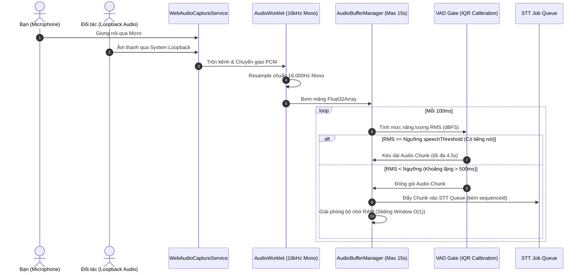
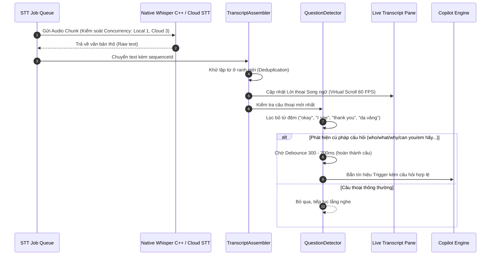
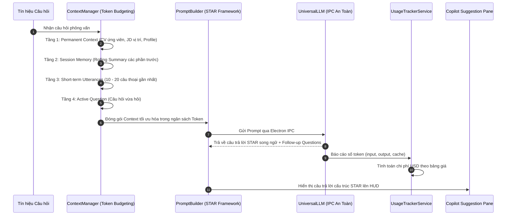
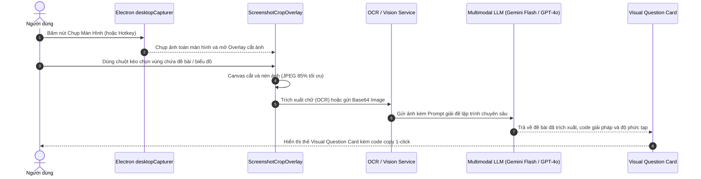
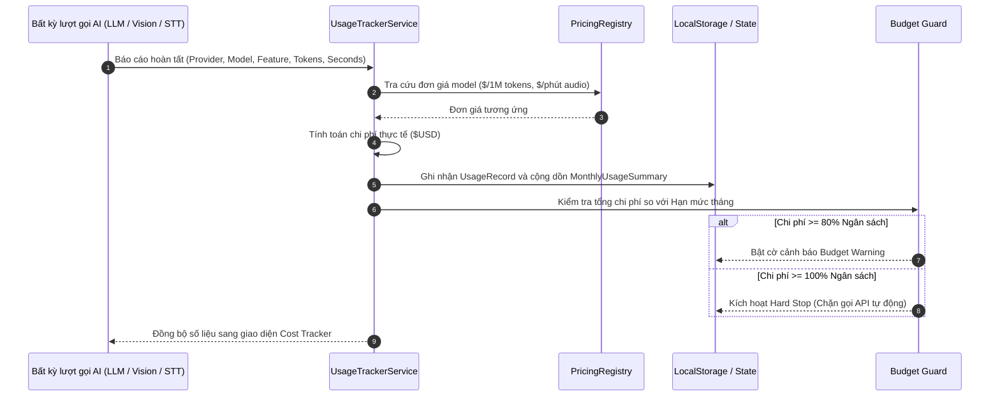

# BÁO CÁO PHÂN TÍCH TOÀN BỘ CODEBASE, CHỨC NĂNG CÁC TRANG & LUỒNG HỆ THỐNG

> **Dự án**: Electron AI Meeting & Interview Copilot  
> **Kiến trúc**: React 19 + TypeScript + Vite + Electron 44 + Whisper C++ Native + OS Credential Store (DPAPI/Keychain)  
> **Cập nhật gần nhất**: 23/10/2026

---

## 🏗️ 1. TỔNG QUAN KIẾN TRÚC TOÀN HỆ THỐNG

Ứng dụng được thiết kế theo mô hình **Overlay HUD / Copilot đa tầng**, bao gồm 2 tiến trình (process) phân tách độc lập và giao tiếp bảo mật qua Electron IPC:

```
┌────────────────────────────────────────────────────────────────────────┐
│                   ELECTRON MAIN PROCESS (Native C++)                   │
│  - Overlay Window Manager (Frameless, Transparent, Always-on-Top)      │
│  - WhisperProcessManager (Quản lý whisper-cli.exe, Watchdog, Download) │
│  - OS Credential Store (Windows DPAPI / macOS Keychain AES Encryption) │
│  - Electron Desktop Capturer (Chụp màn hình mức hệ thống)              │
│  - Session Storage (Lưu trữ file JSON cục bộ trong userData/sessions/) │
└───────────────────────────────────┬────────────────────────────────────┘
                                    │ (Bảo mật IPC Channels)
┌───────────────────────────────────▼────────────────────────────────────┐
│                  REACT RENDERER PROCESS (Giao Diện HUD)                │
│  - Audio Pipeline: AudioWorklet 16kHz Mono + Bounded Buffer + VAD Gate │
│  - STT Job Queue: Concurrency Worker (Local 1, Cloud 3) + Sequencer   │
│  - Question Detector: Heuristic Intent Filter + Debounce 300-700ms     │
│  - Context Engine: 4-Tier Context Manager (Permanent, Summary, Chat)   │
│  - Screen Vision: Screenshot Crop Overlay + OCR + Multimodal Vision AI │
│  - Cost Engine: Usage Tracker + Pricing Registry + Budget Guard        │
└────────────────────────────────────────────────────────────────────────┘
```

1. **Electron Main Process (Native Infrastructure)**:
   - **Overlay Window Controller**: Quản lý cửa sổ vô viền (frameless), nền trong suốt, ghim trên cùng (always-on-top), tự động neo (auto-anchor) cạnh phải màn hình.
   - **WhisperProcessManager**: Native worker quản lý tiến trình `whisper-cli.exe` C++, watchdog giám sát crash/freeze, timeout (8-15s), retry queue, quản lý tải model GGML offline (tiny, base...).
   - **OS Credential Store**: Sử dụng `safeStorage` (Windows DPAPI / macOS Keychain / Linux Secret Service) mã hóa AES cipher trên đĩa (`credentials.enc.json`), tuyệt đối không gửi plaintext key về React Renderer.
   - **Desktop Capturer IPC**: Bắt khung hình màn hình ở cấp độ hệ điều hành phục vụ tính năng giải bài tập/sơ đồ thị giác.
   - **Session Storage**: Quản lý ghi và nạp file JSON session độc lập trong `userData/sessions/`.

2. **React Renderer Process (UI & Audio/AI Pipeline)**:
   - **Audio Pipeline**: Web Audio API bắt Microphone & Loopback System Audio, xử lý trên luồng âm thanh độc lập `AudioWorkletNode` 16kHz mono PCM, bộ đệm trượt giới hạn `AudioBufferManager` (tối đa 15s), bộ lọc VAD tự cân chỉnh theo môi trường.
   - **STT Job Queue**: Hàng đợi trung gian điều tiết tải, kiểm soát concurrency (Local: 1 worker, Cloud: 3 workers), gắn `sequenceId`, xử lý backpressure và tự động drop silence chunk.
   - **Question Detector**: Phân tích intent câu hỏi siêu tốc (heuristic + debounce 300-700ms), lọc bỏ triệt để câu đệm giao tiếp ("okay", "thank you", "dạ vâng").
   - **Tiered Context Manager**: Quản lý token 4 tầng (Permanent Context $\to$ Session Memory Rolling Summary $\to$ Short-term Utterances $\to$ Current Question).
   - **Universal LLM & Response Engine**: Gọi AI Main Process IPC bảo mật hoặc Cloud provider, sinh câu trả lời STAR song ngữ (Anh - Việt), tóm tắt cuộc họp.
   - **Usage Tracker & Cost Engine**: Giám sát lượng token tiêu thụ và chi phí USD theo thời gian thực cho từng provider/model.

---

## 📄 2. CHI TIẾT TÍNH NĂNG TỪNG TRANG & MODULE

Hệ thống được tổ chức thành **7 màn hình chuyên biệt** trên thanh điều hướng Sidebar:

---

### TRANG 1: HOME (Chuẩn Bị, Quản Lý Profile & Phân Tích Trước Cuộc Họp)

_File chính: `src/app/features/home/Home.tsx` và thư mục `src/app/features/home/components/`_

#### Chức năng chi tiết:

1. **Hero Launch Bar**:
   - Chuyển đổi nhanh 2 chế độ cốt lõi:
     - **Interview Mode**: Chế độ phỏng vấn ứng viên tuyển dụng (sinh câu trả lời STAR, bám sát CV & JD).
     - **Discussion Mode**: Chế độ hội thảo công việc / kỹ thuật (sinh giải pháp, luận điểm phản biện, kiến trúc hệ thống).
   - Nút **"Bắt đầu cuộc họp"**: Kiểm tra các điều kiện an toàn (thiết bị âm thanh, context) trước khi chuyển sang Meeting Mode.
2. **Profile Preset Bar (Quản lý Đa Hồ Sơ)**:
   - Cho phép lưu và chuyển đổi linh hoạt nhiều bộ hồ sơ ứng viên khác nhau (VD: _Senior Frontend Engineer_, _DevOps Specialist_, _System Architect_).
   - Hộp thoại `ProfilePresetDialog`: Thêm mới, chỉnh sửa thông tin ứng viên, số năm kinh nghiệm, kỹ năng trọng tâm, ghi chú riêng.
   - Hộp thoại `ProfileImportExportDialog`: Sao lưu và nhập dữ liệu hồ sơ qua file JSON chuẩn hóa.
   - Hộp thoại `ProfileDeleteDialog`: Xác nhận xóa an toàn hồ sơ cũ kèm dọn dẹp liên kết.
3. **Context Editor Card (Trọng tâm soạn thảo dữ liệu)**:
   - Nhập nội dung CV ứng viên, Job Description (JD) hoặc Chủ đề thảo luận (Discussion Topic).
   - **Document Parser**: Tự động trích xuất chữ trực tiếp từ file tài liệu tải lên:
     - File `.pdf` (xử lý qua thư viện `unpdf`/`pdfjs`).
     - File `.docx` (xử lý qua `mammoth`).
     - File `.txt` với dung lượng lên đến 15.000 ký tự.
   - Đo lường dung lượng token ngữ cảnh tức thì theo thời gian thực (`estimateTokenCount`).
   - Nút nạp nhanh dữ liệu mẫu: Sample CV Senior Developer, Sample JD Software Engineer, Sample Discussion Topic.
4. **Phân tích tương thích CV - JD (CV-JD Match Analysis)**:
   - Tích hợp 2 cơ chế phân tích:
     - _Heuristic Keyword Matching_ (chạy offline ngay lập tức không tốn token API).
     - _AI Deep Semantic Matching_ (dùng LLM phân tích chuyên sâu năng lực).
   - Hộp thoại `CvJdMatchDialog` hiển thị:
     - Điểm số tương thích tổng quan (0 - 100%).
     - Danh sách kỹ năng trùng khớp (Matched Skills).
     - Danh sách kỹ năng còn thiếu (Skill Gaps).
     - Dự đoán các câu hỏi phỏng vấn hóc búa nhất mà nhà tuyển dụng có khả năng sẽ hỏi.
5. **Audio Device Selector Card**:
   - Quét và liệt kê danh sách toàn bộ Microphone vật lý và System Audio Loopback trên máy tính.
   - Kiểm tra trạng thái cấp quyền âm thanh và nút quét lại thiết bị (Refresh Devices).
6. **AI Model Selector Card**:
   - Lựa chọn model AI đồng hành (Groq LPU, OpenAI GPT-4o, Google Gemini Flash/Pro).
   - Nút **Test Ping**: Đo độ trễ HTTP thực tế (Round-trip ping ms) tới máy chủ AI tương ứng.
7. **Recent Sessions Card**:
   - Hiển thị danh sách các cuộc họp vừa diễn ra, thống kê thời lượng, số câu hỏi đã hỏi, nút chuyển nhanh sang trang Session History.
8. **System Quick Status Card**:
   - Giám sát tình trạng sẵn sàng của hệ thống: Micro, Whisper Native C++, Trạng thái API Keys, Ngân sách token còn lại.

---

### TRANG 2: MEETING MODE (Trợ Lý Realtime Trong Cuộc Họp & Giải Đề Thị Giác)

_File chính: `src/app/features/meeting-mode/MeetingMode.tsx` và `src/app/features/meeting-mode/components/`_

#### Chức năng chi tiết:

1. **Audio Capture 2 Chiều & Visualizer 60 FPS**:
   - Thu âm đồng thời 2 nguồn: Micro cá nhân của bạn + System Loopback Audio (tiếng đối tác phát ra từ Google Meet, Zoom, Teams, Skype...).
   - Chạy trên Web Audio `AudioWorkletNode` ở luồng riêng, không nghẽn CPU giao diện.
   - Sóng âm thanh động học (Audio Visualizer) chạy trên vòng lặp `requestAnimationFrame` độc lập ngoài React state $\to$ giữ vững **60 FPS** liên tục.
2. **STT Job Queue & Bóc Băng Tự Động**:
   - Tự động cắt lát audio bằng VAD (Voice Activity Detection) thành các chunk 1.5s - 4.5s.
   - Điều tiết hàng đợi `sttJobQueue` với concurrency control: Local Whisper = 1 worker (chống 100% CPU), Cloud = 3 workers.
   - Gắn `sequenceId` bảo đảm lời thoại hiển thị đúng tuần tự thời gian và tự động drop các đoạn im lặng.
3. **Live Transcript Pane (Lời Thoại Song Ngữ Ảo Hóa)**:
   - Hiển thị lời thoại thời gian thực song ngữ (tiếng Anh bản gốc và bản dịch tiếng Việt mượt mà).
   - Kỹ thuật **Ảo hóa danh sách (Virtual Scrolling)**: Đảm bảo cuộc họp kéo dài 90-120 phút với hàng nghìn câu thoại vẫn mượt mà, không giật lag DOM và không tăng bộ nhớ RAM.
   - Thanh tìm kiếm từ khóa trong transcript, nút bật/tắt tự động cuộn (Auto-scroll), nút xuất nhanh lời thoại ra file `.txt`.
4. **Question Detector & Intent Filter (Bộ Lọc Câu Hỏi Thông Minh)**:
   - Phân tích cú pháp câu nói của đối tác theo thời gian thực (who, what, why, how, can you, em hãy, tại sao...).
   - Debounce thông minh 300 - 700ms để chờ người phỏng vấn hoàn thành câu nói.
   - Lọc bỏ triệt để các câu đệm xã giao ("okay", "I see", "thank you", "great", "dạ vâng").
5. **Tiered Context Copilot & Suggestion Pane**:
   - Kiến trúc Context 4 tầng gom: CV/JD $\to$ Tóm tắt cuộc họp đến hiện tại $\to$ 10-20 câu thoại gần nhất $\to$ Câu hỏi vừa hỏi.
   - Tự động sinh câu trả lời cấu trúc **STAR (Situation, Task, Action, Result)** chuẩn mực cho phỏng vấn kỹ thuật và quản lý.
   - Tùy chọn ngôn ngữ phản hồi linh hoạt: Tiếng Anh, Tiếng Việt hoặc Song ngữ.
   - Các nút tương tác nhanh: **Rút ngắn câu trả lời (Shorten)**, **Tạo lại câu trả lời (Regenerate)**, Copy 1-click.
   - Tự động gợi ý trước các câu hỏi tiếp theo (Follow-up Questions) mà đối tác có thể sắp hỏi.
6. **Screen Capture & Visual Coding QA (Giải Đề Bài Thị Giác Từ Màn Hình)**:
   - Hỗ trợ chụp màn hình chia sẻ trực tiếp (Live Screen Sharing) khi gặp bài thi lập trình (LeetCode, HackerRank) hoặc sơ đồ hệ thống.
   - `ScreenshotCropOverlay`: Cho phép dùng chuột kéo chọn đúng vùng câu hỏi trên màn hình.
   - Tự động trích xuất OCR văn bản hoặc truyền ảnh vào Multimodal Vision AI (Gemini 1.5 Flash, GPT-4o).
   - `VisualQuestionCard`: Hiển thị đề bài đã trích xuất, code giải pháp tối ưu kèm phân tích độ phức tạp thời gian/không gian ($O(N)$, $O(1)$).
7. **Tự Động Sinh Biên Bản Cuộc Họp & Lưu Session**:
   - Khi kết thúc cuộc họp, hệ thống tự động sinh biên bản tóm tắt cuộc họp (Executive Summary, Key Takeaways, Next Steps).
   - Tự động lưu toàn bộ dữ liệu vào `userData/sessions/` trên đĩa cứng.

---

### TRANG 3: AUDIO TEST & LAB (Phòng Lab Đo Lường Âm Thanh & Cân Chỉnh VAD)

_File chính: `src/app/features/audio-test/AudioTest.tsx` và `src/app/features/audio-test/components/`_

#### Chức năng chi tiết:

1. **Audio Controls Toolbar**:
   - Chuyển đổi linh hoạt giữa Micro vật lý và System Audio Loopback.
   - Nút Bắt đầu / Dừng thu âm thử nghiệm.
   - Tính năng **Ghi âm & Nghe lại (Playback buffer)**: Kiểm tra chất lượng giọng nói trước khi vào phỏng vấn.
   - Nút tải file âm thanh thử nghiệm `.wav` về máy.
2. **Audio Signal Monitor & Phổ Tần Số**:
   - Đồng hồ đo mức âm lượng VU meter chính xác theo Decibel (-60 dBFS đến 0 dBFS).
   - Phân tích phổ tần số âm thanh 8 băng tần (Frequency Bands Visualizer).
   - Đo thời lượng buffer (Buffer duration) và dung lượng RAM của buffer âm thanh.
3. **Pipeline Stages Card (Giám Sát 5 Chặng Xử Lý)**:
   - Trực quan hóa tiến trình âm thanh theo thời gian thực qua 5 chặng:
     `Audio Capture` $\to$ `VAD Energy Gate` $\to$ `Resampler 16kHz Mono` $\to$ `STT Job Queue` $\to$ `AI Inference Engine`.
4. **STT Preview Panel & Queue Metrics**:
   - Xem trước kết quả bóc băng giọng nói trực tiếp theo thời gian thực.
   - Hỗ trợ chạy các file audio mẫu có sẵn (YouTube tech interview, business call) để kiểm tra độ nhạy mô hình mà không cần nói.
   - Bảng chỉ số hàng đợi STT: `queueDepth`, `processingJobs`, `droppedJobs`, `averageWaitTime`.
5. **Tự Động Cân Chỉnh VAD Theo Môi Trường (Automatic VAD Calibration Modal)**:
   - Thu mẫu môi trường phòng trong 3.0 giây (60 khung 50ms) bằng chính pipeline âm thanh thực tế.
   - Thuật toán phân vị tứ phân vị ($IQR = Q3 - Q1$) loại trừ hoàn toàn các tiếng ồn đột ngột (click chuột, gõ bàn phím cơ, tiếng thở).
   - Tính toán noise floor ở phân vị 65th và cộng thêm `safetyMargin` (+3dB, +6dB, +9dB) để suy ra ngưỡng kích hoạt giọng nói (`speechThreshold`).
   - Phân loại chất lượng môi trường phòng: `pristine` (cực yên tĩnh), `good`, `moderate`, `noisy`, `critical`.
   - **Device Isolation**: Lưu trữ ngưỡng VAD độc lập cho từng mã phần cứng Micro (`deviceId`). Khi chuyển Micro, Meeting Mode tự động nạp cấu hình VAD tương ứng.

---

### TRANG 4: AI DIAGNOSTIC & BENCHMARK (Đo Tốc Độ AI & Thử Nghiệm Vision OCR)

_File chính: `src/app/features/ai-diagnostic/AIDiagnostic.tsx` và `src/app/features/ai-diagnostic/components/`_

#### Chức năng chi tiết:

1. **Tab 1: LLM Latency & Speed Benchmark**:
   - Cho phép chọn bất kỳ model LLM nào từ Groq, OpenAI hoặc Google Gemini.
   - Cung cấp các mẫu prompt thử nghiệm thực tế: _Giải thuật toán LeetCode_, _Câu hỏi phỏng vấn System Design_, _Dịch thuật kỹ thuật_.
   - Đo lường và hiển thị các chỉ số hiệu năng AI chuẩn xác:
     - **TTFT (Time to First Token)**: Thời gian từ lúc gửi yêu cầu đến khi nhận được ký tự đầu tiên (ms).
     - **Tốc độ sinh token (Tokens/sec)**: Tốc độ tạo chữ thực tế của model.
     - **Tổng thời gian xử lý (Total Latency ms)**.
     - **Số lượng token tiêu thụ**: Input tokens, Output tokens và chi phí ước tính.
2. **Tab 2: Screen Capture Vision & OCR Playground**:
   - Thử nghiệm chụp ảnh màn hình bằng native Electron `desktopCapturer`.
   - Cung cấp công cụ cắt ảnh tương tác (Crop Tool) để khoanh vùng bài toán hoặc biểu đồ.
   - Lựa chọn Multimodal Vision Model (Google Gemini 1.5 Flash, OpenAI GPT-4o-mini...).
   - Chạy thử nghiệm phân tích đề bài thị giác và xem trước kết quả OCR trích xuất trước khi bước vào cuộc họp chính thức.

---

### TRANG 5: SESSION HISTORY (Quản Lý, Xem Lại & Hậu Kỳ Cuộc Họp)

_File chính: `src/app/features/session-history/SessionHistory.tsx` và `src/app/features/session-history/components/`_

#### Chức năng chi tiết:

1. **Bố Cục Master-Detail & Sidebar Đa Bộ Lọc**:
   - Cột trái hiển thị danh sách các phiên họp đã lưu kèm bộ lọc đa tiêu chí:
     - Lọc theo chế độ: Tất cả, Phỏng vấn (Interview), Thảo luận (Discussion).
     - Lọc theo Profile ứng viên: _Frontend Dev_, _DevOps Lead_...
     - Lọc theo mốc thời gian: _Hôm nay_, _7 ngày qua_, _30 ngày qua_, _Tất cả_.
     - Tìm kiếm theo Tên công ty / Vị trí ứng tuyển.
   - **Full-Text Search Toàn Diện**: Tìm kiếm tức thì trong toàn bộ tiêu đề, transcript tiếng Anh, transcript dịch tiếng Việt, gợi ý của AI và nội dung OCR từ ảnh chụp màn hình.
   - Thao tác quản lý session: Đổi tên cuộc họp trực tiếp (inline rename), xóa từng session hoặc chọn nhiều để xóa hàng loạt (Bulk Delete) kèm hộp thoại xác nhận an toàn.
2. **Interactive Timeline & Chi Tiết Cuộc Họp**:
   - Header hiển thị tổng quan: Ngày giờ, thời lượng, profile áp dụng, tổng token sử dụng và ước tính chi phí API ($USD).
   - **Tab 1 - Dòng thời gian tích hợp (Unified Timeline)**: Liệt kê sự kiện theo thời gian thực với phân loại màu sắc trực quan:
     - _Câu hỏi người phỏng vấn_ (Theme màu hổ phách, nhãn Question).
     - _Câu trả lời của bạn_ (Theme màu tím, nhãn You).
     - _Gợi ý AI STAR Copilot_ (Theme phát sáng emerald/violet, nhãn AI Suggestion kèm nút copy).
     - _Câu hỏi hình ảnh màn hình_ (Theme cyan/indigo, trích xuất OCR, tóm tắt và code thuật toán).
   - **Tính năng Click-to-Correlate**: Bấm vào mốc thời gian của bất kỳ sự kiện nào để tự động cuộn và highlight câu hỏi hoặc gợi ý AI tương ứng.
   - **Tab 2 - Lời thoại song ngữ (Transcript)**: Xem toàn bộ hội thoại gốc và dịch với chế độ progressive load chống giật lag.
   - **Tab 3 - Gợi ý AI Copilot**: Toàn bộ câu trả lời STAR kèm số token tiêu thụ.
   - **Tab 4 - Visual Coding**: Toàn bộ ảnh chụp màn hình bài tập kèm code lời giải.
   - **Tab 5 - Split View (50:50)**: Đối chiếu song song lời thoại và gợi ý của AI.
3. **Xuất Báo Cáo Đa Định Dạng**:
   - **Xuất Markdown**: Báo cáo đầy đủ định dạng đẹp (kèm Profile, Timeline, Lời thoại song ngữ, Gợi ý STAR, Câu hỏi hình ảnh OCR, Metrics).
   - **Xuất JSON Schema v2.0**: Dữ liệu cấu trúc chuẩn phục vụ sao lưu hoặc phân tích dữ liệu.
   - **Xuất PDF in ấn**: Xuất file tài liệu PDF trực tiếp bằng hàm in hệ thống.
4. **Chính Sách Lưu Trữ Tự Động (Retention Policy)**:
   - Tùy chọn tự động dọn dẹp các phiên họp cũ: Vĩnh viễn (mặc định), 7 ngày, 30 ngày, 90 ngày.
   - Tự động dọn dẹp sạch sẽ artifact ảnh chụp màn hình liên quan khi phiên họp bị xóa.

---

### TRANG 6: COST TRACKER (Quản Lý Ngân Sách & Theo Dõi Chi Phí Token API)

_File chính: `src/app/features/cost-tracker/CostTracker.tsx` và `src/app/features/cost-tracker/components/`_

#### Chức năng chi tiết:

1. **Top Metric Cards (Chỉ Số Tổng Quan Hàng Tháng)**:
   - Hiển thị tức thì: Tổng chi phí tháng hiện tại ($USD), Tổng số lượt gọi API (Requests), Tổng số token tiêu thụ (Input / Output / Cache), Tỷ lệ ngân sách đã dùng (%).
2. **Tab 1: Overview Dashboard (Bàn Điều Khiển Tổng Thể)**:
   - Kết hợp 2 cột: Biểu đồ xu hướng chi phí theo ngày và Biểu đồ tròn phân bổ chi phí.
   - Thẻ quản lý ngân sách và thẻ cấu hình bảng giá model.
3. **Tab 2: Daily Usage Trend Chart (Biểu Đồ Xu Hướng Sử Dụng)**:
   - Trực quan hóa chi phí theo từng ngày với các mốc lựa chọn: 7 ngày, 14 ngày, 30 ngày.
   - Phân tích ngày có lượng gọi API cao nhất (Spike detection) và mức chi tiêu trung bình/ngày.
4. **Tab 3: Distribution Charts (Biểu Đồ Phân Bổ Chi Phí)**:
   - Phân bổ theo **Nhà cung cấp (Provider)**: Tỷ lệ % chi phí giữa Groq, OpenAI, Google Gemini.
   - Phân bổ theo **Tính năng (Feature)**: Tỷ lệ giữa `copilot_interview`, `copilot_discussion`, `speech_to_text`, `summary`, `vision_analysis`.
5. **Tab 4: Recent Usage Logs Table (Nhật Ký Gọi API Chi Tiết)**:
   - Bảng liệt kê chi tiết 200 lượt gọi API gần nhất: Mã request, Thời gian, Provider, Model, Tính năng, Input Tokens, Output Tokens, Cached Tokens, Chi phí USD, Trạng thái.
   - Nút **Xuất file CSV (Export CSV)**: Tải toàn bộ nhật ký gọi API ra file Excel/CSV để lập báo cáo tài chính.
6. **Tab 5: Budget Management (Quản Lý Hạn Mức Chi Tiêu)**:
   - Thiết lập hạn mức ngân sách tối đa hàng tháng ($USD).
   - Thiết lập ngưỡng cảnh báo (Warning threshold, mặc định 80%).
   - Cơ chế bảo vệ: Cảnh báo trực quan khi chạm ngưỡng và chặn gọi API không cần thiết khi vượt hạn mức.
7. **Tab 6: Model Pricing Configuration (Cấu Hình Đơn Giá Token)**:
   - Cho phép người dùng tùy chỉnh hoặc cập nhật giá tiền cho từng model (Input price / 1M tokens, Output price / 1M tokens, Cached price / 1M tokens, Audio price / minute).
   - Nút nạp dữ liệu mẫu (Seed Demo Data) và Nút Reset toàn bộ thống kê cục bộ.

---

### TRANG 7: SETTINGS & SECURITY (Cấu Hình, Engine Native & An Toàn Dữ Liệu)

_File chính: `src/app/features/settings/Settings.tsx` và `src/app/features/settings/components/`_

#### Chức năng chi tiết:

1. **Khóa API AI (Bảo Mật Bằng OS Credential Store)**:
   - Tích hợp chuẩn mã hóa cấp OS: **Windows Credential Manager / DPAPI, macOS Keychain**.
   - Tuyệt đối không lưu plaintext key trong `localStorage`, `IndexedDB` hay file JSON cấu hình.
   - Renderer chỉ nhận trạng thái `configured: true` và `maskedKey` (`gsk_••••••••1234`).
   - Hỗ trợ quản lý độc lập 3 Provider: Groq, OpenAI, Google Gemini.
   - Tính năng **Kiểm tra khóa (Verify API Key)**: Gọi ping API xác thực key sống/chết và cập nhật danh sách model hỗ trợ.
   - Tính năng **Thu hồi/Xóa khóa (Revoke Key)** và **Tự động di chuyển (Auto Migration)** từ key cũ sang vùng lưu trữ an toàn.
   - Nút **Xuất cấu hình an toàn (Export Sanitized Settings)**: Xuất file cấu hình đã loại bỏ 100% secret.
2. **STT Engine Card (Động Cơ Bóc Băng Giọng Nói)**:
   - Lựa chọn giữa **Local Whisper C++** (chạy offline trên máy) và **Cloud STT** (Groq Whisper siêu tốc 120ms).
   - Quản lý Native Worker Whisper C++: Theo dõi trạng thái tiến trình (`READY`, `BUSY`, `STOPPED`, `FAILED`), đo nhiệt độ/CPU và quản lý tải model GGML offline (tiny 75MB, base 142MB).
   - Nút **Kiểm tra sức khỏe Native Engine (Health Check)**: Thử nghiệm bóc băng đoạn audio mẫu nội bộ để xác nhận binary và model hoạt động trơn tru.
3. **LLM Engine Card (Mô Hình AI Copilot)**:
   - Lựa chọn model LLM mặc định cho cuộc họp (Llama 3.3 70B, GPT-4o, Gemini 2.5 Flash...).
   - Nút **Đồng bộ danh sách model (Sync Models)** trực tiếp từ API của từng provider.
4. **Multimodal Vision Model Card**:
   - Cấu hình model chuyên trách xử lý hình ảnh chụp màn hình (Gemini 1.5 Flash, GPT-4o-mini...).
5. **Meeting Audio & VAD Config Card**:
   - Chọn Microphone mặc định.
   - Thanh trượt điều chỉnh độ nhạy VAD (0.1 - 1.0).
   - Lựa chọn ngôn ngữ phản hồi mặc định của AI: Tiếng Việt, Tiếng Anh, Song ngữ.
   - Bật/tắt chế độ cá nhân hóa câu trả lời dựa trên kinh nghiệm trong CV.

---

## 🔄 3. CÁC LUỒNG HỆ THỐNG CHÍNH (CORE SYSTEM WORKFLOWS)

Dưới đây là 6 luồng dữ liệu cốt lõi vận hành toàn bộ hệ thống:

---

### LUỒNG 1: Thu Âm 2 Chiều & Lọc Khoảng Lặng VAD (Real-time Audio & VAD Pipeline)



---

### LUỒNG 2: Bóc Băng STT & Nhận Diện Ý Định Câu Hỏi (STT & Question Intent Flow)



---

### LUỒNG 3: Quản Lý Ngữ Cảnh 4 Tầng & Phản Hồi STAR Copilot (Tiered Context & AI Copilot Flow)



---

### LUỒNG 4: Chụp Màn Hình & Giải Đề Bài Thị Giác (Screen Capture & Visual Coding QA Flow)



---

### LUỒNG 5: Giám Sát Chi Phí & Hạn Mức Ngân Sách (API Cost & Budget Guard Flow)



---

### LUỒNG 6: Bảo Mật Khóa API & Mã Hóa Native (OS Credential Security & IPC Flow)

```mermaid
sequenceDiagram
    autonumber
    actor User as Người dùng (Settings)
    participant Renderer as React Renderer
    participant IPC as Electron IPC Channel
    participant SafeStore as OS safeStorage (DPAPI / Keychain)
    participant Disk as File credentials.enc.json
    participant Cloud as AI Cloud Server (Groq / OpenAI / Google)

    User->>Renderer: Nhập API Key (vd: gsk_123456789)
    Renderer->>IPC: Gửi payload qua channel `credentials:save`
    IPC->>SafeStore: Gọi `safeStorage.encryptString(apiKey)`
    SafeStore-->>IPC: Trả về Buffer mã hóa AES bằng khóa cấp OS
    IPC->>Disk: Ghi Buffer mã hóa xuống đĩa
    IPC-->>Renderer: Chỉ trả về `{ configured: true, maskedKey: 'gsk_••••••••6789' }`
    Note over Renderer: Tuyệt đối KHÔNG lưu plaintext key trong bộ nhớ trình duyệt!

    rect rgb(30, 41, 59)
    Note over Renderer,Cloud: Khi cần gọi AI Inference:
    Renderer->>IPC: Gửi prompt và modelId (không gửi API Key)
    IPC->>Disk: Đọc Buffer mã hóa
    IPC->>SafeStore: Giải mã `safeStorage.decryptString()` trong Main Process
    IPC->>Cloud: Thực hiện HTTPS Request trực tiếp kèm Authorization Header
    Cloud-->>IPC: Trả về kết quả AI
    IPC-->>Renderer: Trả về nội dung phản hồi
    end
```


