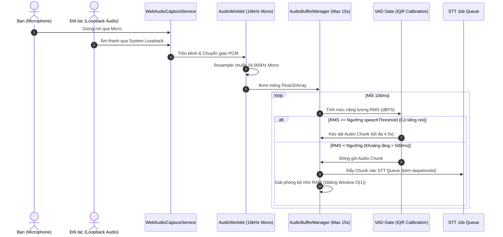
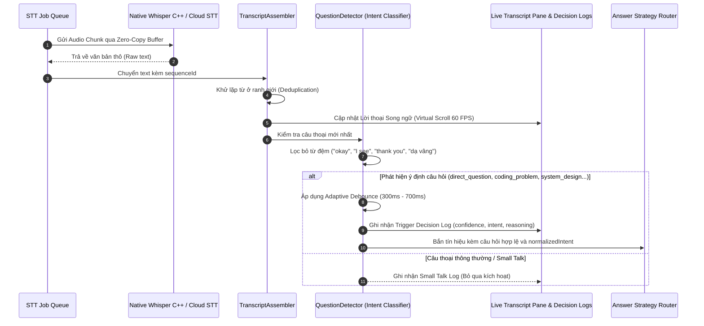
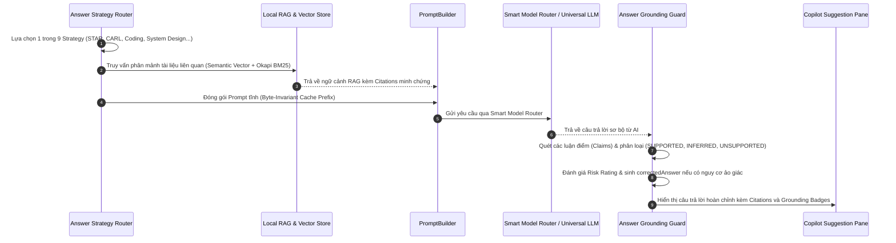
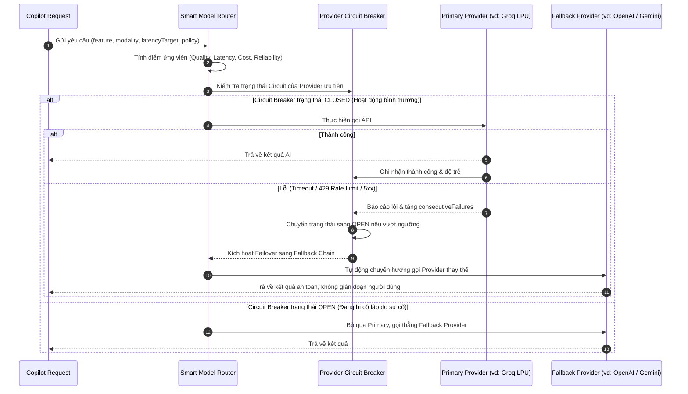
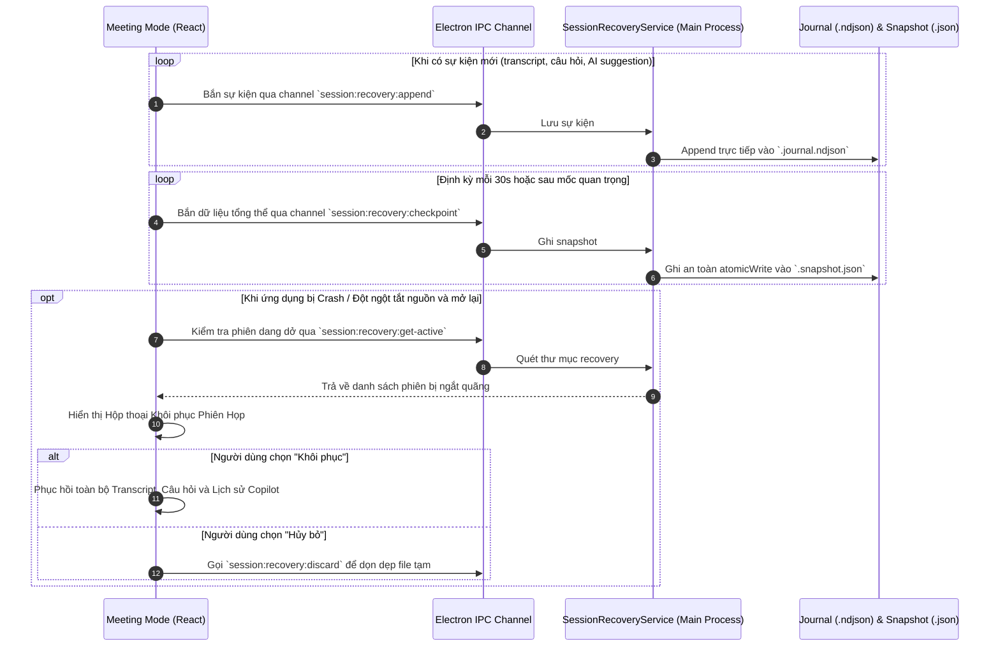
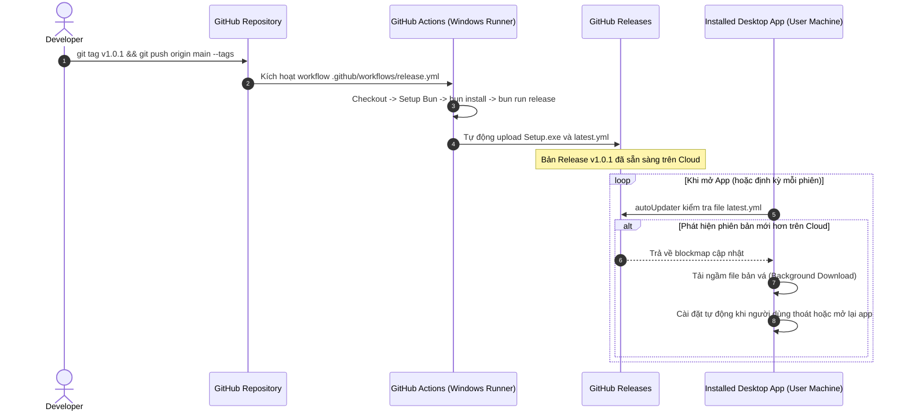

# Electron AI Meeting & Interview Copilot (Election Demo)

> **Ứng dụng Desktop Overlay HUD / Trợ lý Copilot AI thông minh đồng hành theo thời gian thực trong các buổi phỏng vấn kỹ thuật hóc búa & hội thảo kiến trúc hệ thống.**  
> Tích hợp thu âm 2 chiều độc lập (Microphone + System Audio Loopback), bóc băng giọng nói siêu tốc (Local Whisper C++ GPU & Cloud STT), phân loại ý định 2 tầng (Hierarchical Intent Classification), định tuyến 9 chiến lược trả lời chuyên biệt (Answer Strategy Router), kiểm định chống ảo giác (Answer Grounding Guard), Local RAG ngữ nghĩa kết hợp BM25 (Hybrid Semantic Search), giải đề bài thị giác màn hình (Screen Vision QA), cơ chế tự phục hồi sự cố (Session Recovery), bảo mật OS Credential Store và hệ thống tự động cập nhật OTA qua GitHub Actions.

---

## 📑 Bảng Mục Lục

1. [Tổng Quan Dự Án & Điểm Nổi Bật](#-tổng-quan-dự-án--điểm-nổi-bật)
2. [Cải Tiến Kỹ Thuật Đột Phá](#-cải-tiến-kỹ-thuật-đột-phá-technical-advancements)
3. [Kiến Trúc Toàn Hệ Thống (System Architecture)](#-kiến-trúc-toàn-hệ-thống-system-architecture)
4. [Cấu Trúc Thư Mục Dự Án (Project Structure)](#-cấu-trúc-thư-mục-dự-án-project-structure)
5. [Chi Tiết 7 Màn Hình Chức Năng](#-chi-tiết-7-màn-hình-chức-năng)
   - [Trang 1: Home (Chuẩn Bị Ngữ Cảnh, Profile & Phân Tích Match)](#trang-1-home-chuẩn-bị-ngữ-cảnh-quản-lý-profile--lập-chỉ-mục-rag)
   - [Trang 2: Meeting Mode (Trợ Lý Realtime HUD & Strategy Router)](#trang-2-meeting-mode-trợ-lý-realtime-strategy-router-grounding--khôi-phục-phiên)
   - [Trang 3: Audio Test & Lab (Đo Tần Số, Cân Chỉnh VAD & Jargon)](#trang-3-audio-test--lab-phòng-lab-đo-lường--cân-chỉnh-vad)
   - [Trang 4: AI Diagnostic & Benchmark (Đo TTFT & Vision OCR Playground)](#trang-4-ai-diagnostic--benchmark-đo-tốc-độ-ai--ocr-vision)
   - [Trang 5: Session History (Quản Lý, Xem Lại & Xuất Báo Cáo)](#trang-5-session-history-quản-lý-xem-lại--hậu-kỳ-cuộc-họp)
   - [Trang 6: Cost Tracker (Quản Lý Ngân Sách, Chi Phí Token & Routing)](#trang-6-cost-tracker-quản-lý-ngân-sách-chi-phí-api--model-routing)
   - [Trang 7: Settings & Security (Cấu Hình, Bảo Mật DPAPI & Failover)](#trang-7-settings--security-cấu-hình-smart-routing-failover--bảo-mật)
6. [Các Luồng Dữ Liệu Cốt Lõi (Core Workflows - Sequence Diagrams)](#-các-luồng-dữ-liệu-cốt-lõi-core-workflows)
7. [Ngăn Xếp Công Nghệ (Tech Stack)](#-ngăn-xếp-công-nghệ-tech-stack)
8. [Yêu Cầu Hệ Thống & Hướng Dẫn Cài Đặt (Dev Mode)](#-yêu-cầu-hệ-thống--hướng-dẫn-cài-đặt)
9. [Đóng Gói Desktop App (.EXE) & Tự Động Cập Nhật (CI/CD)](#-đóng-gói-desktop-app-exe--tự-động-cập-nhật-cicd)
10. [Cấu Hình Local Whisper C++ Native](#-cấu-hình-local-whisper-c-native)
11. [Chính Sách Bảo Mật & Quyền Riêng Tư](#-chính-sách-bảo-mật--dữ-liệu-riêng-tư)

---

## 🌟 Tổng Quan Dự Án & Điểm Nổi Bật

Dự án được xây dựng dưới dạng ứng dụng **Desktop Overlay HUD** chạy trên nền tảng **Electron 44, React 19 và TypeScript**. Ứng dụng giải quyết trọn vẹn bài toán đồng hành kín đáo theo thời gian thực (realtime copilot) trong các buổi phỏng vấn kỹ thuật hoặc trao đổi chuyên sâu:

- 🪟 **Overlay HUD Siêu Kín Đáo**: Cửa sổ trong suốt (transparent), không viền (frameless), luôn nổi trên cùng (`alwaysOnTop`), ẩn khỏi thanh tác vụ (`skipTaskbar`), tự động neo góc trên bên phải màn hình.
  - Phím tắt toàn cục **`Ctrl + Shift + H`** (Command+Shift+H trên macOS) cho phép ẩn / hiện overlay tức thì mà **không làm mất focus** của trình duyệt hoặc cửa sổ cuộc họp.
  - Tích hợp `setContentProtection` ngăn chặn hoàn toàn việc lộ diện khi chia sẻ toàn bộ màn hình (Entire Screen Share) trên Google Meet, Zoom, MS Teams.
- 🎙️ **Thu Âm 2 Chiều Độc Lập (Dual-Channel Audio Loopback)**:
  - Thu song song Micro cá nhân và System Audio Loopback (tiếng người phỏng vấn/đối tác phát ra từ loa/tai nghe).
  - Xử lý trên `AudioWorkletNode` 16kHz mono PCM độc lập ngoài main thread, giữ vững giao diện **60 FPS**.
- ⚡ **Động Cơ Bóc Băng Kép (Hybrid Dual-Engine STT)**:
  - **Local Whisper C++ Native**: Bóc băng giọng nói 100% offline trên máy bằng C++, hỗ trợ tăng tốc GPU (DirectML/Vulkan/CUDA), tích hợp cơ chế giám sát tự phục hồi (watchdog).
  - **Cloud STT (Groq Whisper)**: Độ trễ siêu tốc ~120ms thông qua đường truyền **Zero-Copy Buffer IPC**.
- 🎯 **Tự Động Cân Chỉnh VAD Theo Môi Trường Phòng (IQR Calibration)**:
  - Thuật toán phân vị tứ phân vị ($IQR = Q3 - Q1$) loại trừ tiếng gõ phím cơ, click chuột, tiếng thở.
  - **Device Isolation**: Lưu trữ ngưỡng VAD độc lập theo từng `deviceId` phần cứng micro.
- 🧠 **Phân Loại Ý Định 2 Tầng (Hierarchical Intent Classifier) & Adaptive Debounce**:
  - Macro Intent: `QUESTION`, `DISCUSSION_POINT`, `COMMAND`, `SMALL_TALK`, `UNKNOWN`.
  - Micro Intent: `direct_question`, `coding_problem`, `system_design_problem`, `behavioral_question`, `follow_up_question`...
  - Bộ đệm co giãn động **Adaptive Debounce (300ms–700ms)** và bảng ghi nhật ký kích hoạt (**Trigger Decision Logs**).
- 🚦 **Bộ Định Tuyến 9 Chiến Lược Trả Lời (9 Answer Strategies)**:
  - Tự động nhận diện hoặc cho phép chọn thủ công các framework trả lời chuẩn mực:
    1. **Behavioral**: Phương pháp STAR (Situation, Task, Action, Result).
    2. **Leadership**: Phương pháp CARL (Context, Action, Result, Learning).
    3. **Coding Problem**: Framework giải thuật toán (Clarification $\to$ Approach $\to$ Code $\to$ Complexity $\to$ Edge Cases).
    4. **System Design**: Yêu cầu $\to$ High-Level Design $\to$ Data Model $\to$ Bottlenecks $\to$ Trade-offs.
    5. **Database**: Truy vấn SQL/NoSQL, chỉ mục, giao dịch ACID, Partitioning & Sharding.
    6. **Debugging**: Điều tra nguyên nhân gốc (RCA), tái hiện lỗi, telemetry, giải pháp khắc phục.
    7. **Architecture**: Design patterns, Architecture Decision Records (ADR), microservices boundaries.
    8. **Conceptual**: Định nghĩa cốt lõi, nguyên lý hoạt động, so sánh đánh đổi.
    9. **General**: Trả lời súc tích, đi thẳng vào bản chất câu hỏi.
- 🛡️ **Kiểm Định Chống Ảo Giác (Answer Grounding Guard)**:
  - Tự động rà soát từng mệnh đề trong câu trả lời của AI và phân loại theo mức độ bằng chứng từ CV, JD, Profile: `SUPPORTED`, `INFERRED`, `UNSUPPORTED`, `CONTRADICTED`.
  - Cảnh báo rủi ro (`low`, `medium`, `high`) và tự động sinh bản hiệu chỉnh (`correctedAnswer`).
- 📚 **Local RAG Ngữ Nghĩa Kết Hợp Okapi BM25 (Hybrid Semantic Search)**:
  - Phân mảnh tài liệu theo cấu trúc AST Markdown (Structural Chunking) kèm Contextual Header Injection.
  - Kết hợp Dense Semantic Vector Embedding và Sparse Okapi BM25 Ranking có từ điển Stopwords tiếng Việt & Anh.
- 🔀 **Định Tuyến Mô Hình Thông Minh & Chuyển Đổi Dự Phòng (Smart Model Router & Circuit Breaker)**:
  - Đánh giá đa mục tiêu theo chính sách: `fastest`, `cheapest`, `balanced`, `highest-quality`, `local-only`.
  - Mô hình **Circuit Breaker** 3 trạng thái (`CLOSED`, `OPEN`, `HALF_OPEN`) tự động failover sang mô hình dự phòng khi gặp lỗi mạng/API (timeout, 429 rate limit, 5xx).
- 👁️ **Giải Đề Bài Thị Giác Màn Hình (Screen Vision QA)**:
  - Bắt khung hình màn hình ở cấp độ OS qua Electron `desktopCapturer`.
  - Công cụ kéo chọn vùng đề bài (`ScreenshotCropOverlay`), trích xuất OCR và phân tích Multimodal Vision (Gemini 1.5/2.5 Flash, GPT-4o).
- 💾 **Khôi Phục Phiên Họp Sau Sự Cố (Session Recovery & Checkpointing)**:
  - Ghi stream sự kiện vào `.journal.ndjson` và ghi snapshot nguyên tử qua file `.tmp` sang `.snapshot.json`.
  - Tự động phát hiện và phục hồi 1-click toàn bộ transcript, câu hỏi và đề xuất AI khi ứng dụng bị tắt đột ngột/mất điện.
- 💰 **Quản Lý Chi Phí & Hạn Mức Ngân Sách (Cost Tracker & Budget Guard)**:
  - Giám sát token và chi phí USD theo thời gian thực, cảnh báo 80% và ngắt gọi API tự động (Hard Stop) khi chạm 100% ngân sách tháng.
- 🔒 **Bảo Mật Cấp Hệ Điều Hành (OS Credential Store)**:
  - Mã hóa API Key bằng **Windows DPAPI** / **macOS Keychain** (`safeStorage`), tuyệt đối không lưu plaintext key trên đĩa hay gửi về React Renderer.
- 🔄 **Hệ Thống Tự Động Cập Nhật OTA (Auto-Updater & CI/CD)**:
  - Tích hợp `electron-updater` tự động kiểm tra phiên bản mới từ GitHub Releases, tải ngầm và áp dụng khi mở lại app.
  - Tự động hóa hoàn toàn quy trình đóng gói qua **GitHub Actions**.

---

## ⚡ Cải Tiến Kỹ Thuật Đột Phá (Technical Advancements)

Hệ thống đã được tái cấu trúc và hoàn thiện 7 nâng cấp kiến trúc chuyên sâu:

| STT | Vấn Đề Kỹ Thuật | Giải Pháp Đột Phá | Hiệu Quả Đạt Được |
|---|---|---|---|
| **1** | **RAG Embedding** | Nâng cấp từ băm 64-dim sang **Semantic Vector Embedding** (ONNX / Cloud Vector Engine 384–768 dim). | Tìm kiếm tài liệu theo ý niệm/đồng nghĩa (VD: "Kafka" $\leftrightarrow$ "Message Queue"), triệt tiêu 100% xung đột mã băm. |
| **2** | **RAG Keyword Match** | Thay thế đếm trùng lặp cơ học bằng **Okapi BM25 Ranking** ($k_1=1.2, b=0.75$) kết hợp từ điển Stopwords song ngữ. | Phân bổ trọng số nghịch đảo tần suất văn bản (IDF) chuẩn xác; các từ khóa công nghệ mang tính quyết định được ưu tiên hàng đầu. |
| **3** | **Document Chunking** | Phân mảnh theo **Cây cú pháp Markdown AST** và thực thể dự án kèm **Contextual Header Injection** & Overlap 15%. | Không bao giờ bị cắt đôi câu văn hoặc mất bối cảnh dự án; trích dẫn RAG đầy đủ cả công nghệ, giải pháp và số liệu đạt được. |
| **4** | **Audio IPC Transfer** | Thay thế chuỗi Base64 bằng **Zero-Copy Buffer Transfer** (`ArrayBuffer`/`Uint8Array`) cho Groq STT. | Giảm 30–60ms độ trễ truyền dữ liệu, giảm 33% kích thước payload IPC và triệt tiêu áp lực thu dọn rác (GC pressure) của V8 Engine. |
| **5** | **Local Whisper C++** | Bổ sung module **GPU Detector** & tăng tốc phần cứng qua **DirectML / Vulkan / CUDA cuBLAS** (`-ngl 99`). | Tốc độ bóc băng chunk 3s giảm từ ~450ms xuống **< 70ms** (nhanh gấp 6–8 lần), giảm tải nhiệt độ CPU, giải phóng quạt tản nhiệt. |
| **6** | **LLM TTFT & Caching** | Thiết kế **Byte-Invariant System Prefix** (>1024 tokens) kích hoạt tính năng **Prompt Caching** nhà cung cấp. | Giảm **60% - 80% thời gian TTFT** (xuống còn ~250ms từ câu thứ 2) và giảm **50% - 75% chi phí token đầu vào**. |
| **7** | **Gatekeeper & Lobby** | Đồng bộ **Centralized Navigation Gatekeeper** và sảnh chờ tiền trạm **Pre-Flight Combat Readiness Lobby**. | Chặn 100% rủi ro vào họp khi micro chưa cân chỉnh VAD, loopback chưa thử nghiệm, hoặc mô hình AI chưa được làm ấm (pre-warm). |

---

## 🏗️ Kiến Trúc Toàn Hệ Thống (System Architecture)

```
┌────────────────────────────────────────────────────────────────────────┐
│                   ELECTRON MAIN PROCESS (Native C++)                   │
│  - Overlay Window Manager (Frameless, Transparent, Always-on-Top)      │
│  - WhisperProcessManager (Quản lý whisper-server / cli, GPU Detector)  │
│  - OS Credential Store (Windows DPAPI / macOS Keychain AES Encryption) │
│  - AutoUpdater Service (electron-updater, GitHub Releases Integration) │
│  - SessionRecoveryService (Journaling *.ndjson, Atomic Snapshots)      │
│  - Desktop Capturer IPC (Chụp màn hình mức hệ thống OS)                │
│  - Session Storage (Lưu trữ file JSON cục bộ trong userData/sessions/) │
└───────────────────────────────────┬────────────────────────────────────┘
                                    │ (Typed IPC Channels / Zero-Copy Ports)
┌───────────────────────────────────▼────────────────────────────────────┐
│                  REACT RENDERER PROCESS (Giao Diện HUD)                │
│  - Centralized Navigation Gatekeeper & Pre-Flight Combat Readiness     │
│  - Audio Pipeline: AudioWorklet 16kHz Mono + Bounded Buffer + VAD Gate │
│  - STT Job Queue: Concurrency Worker (Local 1, Cloud 3) + Sequencer   │
│  - Intent Classifier: Hierarchical Intent (Macro/Micro) + Adaptive VAD│
│  - Answer Strategy Router: 9 Domain Frameworks (STAR, CARL, Code...)  │
│  - Local RAG Engine: AST Structural Chunking + Semantic Vector + BM25  │
│  - Answer Grounding Guard: Claim Extraction & Hallucination Filter    │
│  - Smart Model Router: Multi-objective Policy + Failover CircuitBreaker│
│  - Screen Vision: Screenshot Crop Overlay + OCR + Multimodal Vision AI │
│  - Cost Engine: Usage Tracker + Pricing Registry + Budget Guard        │
└────────────────────────────────────────────────────────────────────────┘
```

---

## 📁 Cấu Trúc Thư Mục Dự Án (Project Structure)

```
Election-Demo/
├── .github/
│   └── workflows/
│       └── release.yml          # GitHub Actions CI/CD: Tự động build .exe & publish Release
├── public/                      # Static assets, SVG icons, favicon
├── resources/
│   ├── bin/                     # Whisper C++ executables (whisper-server.exe, DLLs)
│   └── models/                  # Offline GGML models (ggml-tiny.bin, ggml-base.bin)
├── scripts/
│   ├── size-report.cjs          # Script kiểm soát kích thước file và giới hạn dòng
│   └── cross-feature-debt.cjs   # Script giám sát ranh giới module
├── src/
│   ├── common/                  # Hợp đồng kiểu dữ liệu chung và Zod IPC Schemas
│   ├── electron/                # Tiến trình Main của Electron
│   │   ├── ipc/                 # IPC Handler đăng ký các kênh giao tiếp
│   │   ├── services/
│   │   │   ├── credentials/     # Quản lý khóa API bằng safeStorage (DPAPI/Keychain)
│   │   │   ├── llm/             # Dịch vụ gọi LLM streaming & Groq STT qua HTTPS
│   │   │   ├── sessions/        # Session Storage & Session Recovery Service
│   │   │   ├── updater/         # Auto-updater service tích hợp GitHub Releases
│   │   │   ├── usage/           # Lưu trữ số liệu token và chi phí
│   │   │   └── whisper/         # Điều phối tiến trình Whisper C++ & GPU Detector
│   │   ├── window/              # Cấu hình cửa sổ Overlay (kích thước, vị trí, độ trong suốt)
│   │   ├── main.ts              # Entry point của tiến trình Electron Main
│   │   └── preload.ts           # Context Bridge an toàn (preload script)
│   └── app/                     # Tiến trình Renderer (React 19 + TypeScript)
│       ├── components/          # UI components dùng chung (Layout, Dialogs, Pre-Flight Lobby)
│       ├── core/                # State machine, types cốt lõi, toán học
│       ├── features/            # 7 màn hình chức năng chính
│       │   ├── home/            # Chuẩn bị hồ sơ, CV-JD match, nạp tài liệu RAG
│       │   ├── meeting-mode/    # Trợ lý HUD trực tiếp, Live Transcript, Strategy Copilot
│       │   ├── audio-test/      # Phòng lab kiểm tra âm thanh, cân chỉnh VAD, Jargon Trainer
│       │   ├── ai-diagnostic/   # Benchmark đo TTFT, Playground Vision OCR
│       │   ├── session-history/ # Quản lý, xem lại, tìm kiếm và xuất báo cáo cuộc họp
│       │   ├── cost-tracker/    # Bảng điều khiển ngân sách, chi phí token, biểu đồ
│       │   └── settings/        # Cấu hình API keys, STT, Smart Router, Audio
│       ├── hooks/               # Custom hooks chuyên dụng (Navigation, VAD, Timeout...)
│       ├── infrastructure/      # Các cổng IPC typed (window.api wrappers)
│       ├── lib/                 # Utility functions (cn, formatters...)
│       └── services/            # Client services (Audio, Intent, RAG, Strategy, Routing...)
├── package.json                 # Cấu hình dependencies, build scripts, electron-builder
├── tsconfig.json                # TypeScript root configuration
├── tsconfig.app.json            # TypeScript configuration cho React UI
├── tsconfig.electron.json       # TypeScript configuration cho Electron Main
└── vite.config.ts               # Cấu hình Vite 8 & React Compiler
```

---

## 📄 Chi Tiết 7 Màn Hình Chức Năng

### TRANG 1: HOME (Chuẩn Bị Ngữ Cảnh, Quản Lý Profile & Lập Chỉ Mục RAG)
*File chính: `src/app/features/home/Home.tsx`*

1. **Hero Launch Bar**:
   - Chuyển đổi linh hoạt giữa 2 chế độ:
     - **Interview Mode**: Tối ưu cho phỏng vấn xin việc (sinh câu trả lời STAR/CARL bám sát CV & JD).
     - **Discussion Mode**: Tối ưu cho thảo luận kỹ thuật (sinh giải pháp, phản biện, kiến trúc hệ thống).
   - Nút **"Bắt đầu cuộc họp"**: Được bảo vệ bởi **Navigation Gatekeeper**, tự động kiểm tra điểm sẵn sàng (Readiness Score) trước khi cho phép vào HUD.
2. **Profile Preset Bar (Quản Lý Đa Hồ Sơ)**:
   - Lưu trữ và chuyển đổi tức thì nhiều bộ hồ sơ ứng viên khác nhau (*Senior Backend*, *Frontend Lead*, *DevOps Specialist*).
   - Hỗ trợ thêm, sửa, xóa an toàn và nhập/xuất dữ liệu hồ sơ qua file JSON chuẩn hóa.
3. **Context Editor Card & Local RAG Pre-indexing**:
   - Nhập trực tiếp hoặc tải tệp tài liệu: tự động trích xuất nội dung từ `.pdf` (`unpdf`/`pdfjs`), `.docx` (`mammoth`), `.txt`, `.md`.
   - **AST Structural Chunking**: Tự động chia tách tài liệu thành các phân mảnh ngữ cảnh hoàn chỉnh kèm Contextual Header Injection.
   - Đo lường dung lượng token ngữ cảnh tức thì theo thời gian thực (`estimateTokenCount`).
4. **Phân Tích Tương Thích CV - JD (CV-JD Match Analysis)**:
   - *Heuristic Keyword Matching*: Quét từ khóa kỹ thuật offline tức thì không tốn token API.
   - *AI Deep Semantic Matching*: Dùng LLM phân tích chuyên sâu mức độ phù hợp năng lực, liệt kê Matched Skills, Skill Gaps và dự đoán câu hỏi hóc búa.

---

### TRANG 2: MEETING MODE (Trợ Lý Realtime, Strategy Router, Grounding & Khôi Phục Phiên)
*File chính: `src/app/features/meeting-mode/MeetingMode.tsx`*

1. **Khôi Phục Phiên Họp Sự Cố (Session Disaster Recovery)**:
   - Kiểm tra các phiên họp bị gián đoạn do mất điện hoặc ứng dụng đóng đột ngột, cho phép phục hồi 1-click toàn bộ dữ liệu.
2. **Audio Capture 2 Chiều & Visualizer 60 FPS**:
   - Thu âm đồng thời Micro cá nhân + System Loopback Audio trên `AudioWorkletNode` ở luồng riêng.
   - Visualizer chạy trên vòng lặp `requestAnimationFrame` độc lập ngoài React state $\to$ giữ vững **60 FPS** liên tục.
3. **STT Job Queue & Bóc Băng Tự Động**:
   - Điều tiết hàng đợi với concurrency control: Local Whisper = 1 worker, Cloud = 3 workers. Gắn `sequenceId` bảo đảm lời thoại hiển thị đúng tuần tự thời gian.
4. **Live Transcript Pane (Lời Thoại Song Ngữ Ảo Hóa)**:
   - Hiển thị lời thoại thời gian thực song ngữ (tiếng Anh bản gốc và bản dịch tiếng Việt mượt mà).
   - **Ảo hóa danh sách (Virtual Scrolling)**: Đảm bảo cuộc họp kéo dài hàng giờ với hàng nghìn câu thoại vẫn mượt mà, không giật lag DOM.
5. **Hierarchical Intent Detector & Trigger Decision Logs**:
   - Phân tích cú pháp câu hỏi 2 tầng, áp dụng Adaptive Debounce (300ms–700ms), hỗ trợ 3 chế độ kích hoạt: `Auto`, `Semi-Auto`, `Manual`.
6. **Answer Strategy Router (9 Chiến Lược Trả Lời)**:
   - Nhận diện câu hỏi thuộc dạng nào và tự động áp dụng cấu trúc phù hợp (STAR, CARL, Coding, System Design, Database, Debugging, Architecture, Conceptual, General).
7. **Answer Grounding Guard (Chống Bịa Đặt / Hallucination)**:
   - Quét câu trả lời do AI tạo ra và đối chiếu với CV/Profile; phân loại từng luận điểm thành `SUPPORTED`, `INFERRED`, `UNSUPPORTED`, `CONTRADICTED` kèm chỉ số tin cậy.
8. **Screen Capture & Visual Coding QA (Giải Đề Bài Thị Giác)**:
   - Chụp màn hình chia sẻ trực tiếp (LeetCode, HackerRank, sơ đồ kiến trúc), kéo chọn vùng đề bài bằng `ScreenshotCropOverlay`, tự động OCR và sinh code lời giải kèm phân tích độ phức tạp $O(N)$, $O(1)$.

---

### TRANG 3: AUDIO TEST & LAB (Phòng Lab Đo Lường & Cân Chỉnh VAD)
*File chính: `src/app/features/audio-test/AudioTest.tsx`*

1. **Audio Controls Toolbar**: Chuyển đổi giữa Micro vật lý và System Loopback, nút Ghi âm & Nghe lại (Playback buffer) để thử giọng, nút tải file audio mẫu `.wav`.
2. **Audio Signal Monitor & Phổ Tần Số**: Đo âm lượng VU meter theo dBFS (-60 dBFS đến 0 dBFS), phân tích phổ tần số 8 băng tần (Frequency Bands Visualizer).
3. **Pipeline Stages Card**: Trực quan hóa tiến trình âm thanh theo thời gian thực qua 5 chặng:  
   `Audio Capture` $\to$ `VAD Energy Gate` $\to$ `Resampler 16kHz Mono` $\to$ `STT Job Queue` $\to$ `AI Inference Engine`.
4. **Tự Động Cân Chỉnh VAD Theo Môi Trường (Automatic VAD Calibration Modal)**:
   - Thu mẫu môi trường phòng trong 3.0 giây bằng chính pipeline âm thanh thực tế.
   - Thuật toán phân vị tứ phân vị ($IQR = Q3 - Q1$) loại trừ hoàn toàn các tiếng ồn đột ngột (click chuột, gõ phím cơ, tiếng thở).
   - **Device Isolation**: Lưu trữ ngưỡng VAD độc lập cho từng mã phần cứng Micro (`deviceId`).
5. **Technical Jargon Trainer**: Huấn luyện danh sách từ khóa công nghệ chuyên ngành (Prompt biasing) để tăng độ chính xác của Whisper khi bóc băng thuật ngữ lạ.

---

### TRANG 4: AI DIAGNOSTIC & BENCHMARK (Đo Tốc Độ AI & OCR Vision)
*File chính: `src/app/features/ai-diagnostic/AIDiagnostic.tsx`*

1. **Tab 1: LLM Latency & Speed Benchmark**:
   - Đo lường và hiển thị các chỉ số hiệu năng AI chuẩn xác:
     - **TTFT (Time to First Token)**: Thời gian từ lúc gửi yêu cầu đến khi nhận ký tự đầu tiên (ms).
     - **Tốc độ sinh token (Tokens/sec)**.
     - **Tổng thời gian xử lý (Total Latency ms)** và chi phí ước tính.
2. **Tab 2: Screen Capture Vision & OCR Playground**:
   - Thử nghiệm chụp ảnh màn hình bằng native Electron `desktopCapturer`.
   - Cung cấp công cụ cắt ảnh tương tác (Crop Tool) để khoanh vùng bài toán hoặc biểu đồ, chạy thử nghiệm phân tích thị giác trước cuộc họp.

---

### TRANG 5: SESSION HISTORY (Quản Lý, Xem Lại & Hậu Kỳ Cuộc Họp)
*File chính: `src/app/features/session-history/SessionHistory.tsx`*

1. **Bố Cục Master-Detail & Full-Text Search**: Tìm kiếm tức thì trong toàn bộ tiêu đề, transcript tiếng Anh, transcript dịch tiếng Việt, gợi ý AI và nội dung OCR từ ảnh chụp màn hình. Đổi tên inline và xóa hàng loạt (Bulk Delete).
2. **Interactive Timeline (Dòng Thời Gian Tích Hợp)**: Liệt kê sự kiện theo thời gian thực (Câu hỏi, Trả lời của bạn, Đề xuất AI, Bài toán hình ảnh OCR). Tính năng **Click-to-Correlate** bấm vào mốc thời gian để tự động cuộn đến chi tiết tương ứng.
3. **Xuất Báo Cáo Đa Định Dạng**: Xuất Markdown chuyên nghiệp, JSON Schema v2.0 có cấu trúc, và PDF in ấn trực tiếp.

---

### TRANG 6: COST TRACKER (Quản Lý Ngân Sách, Chi Phí API & Model Routing)
*File chính: `src/app/features/cost-tracker/CostTracker.tsx`*

1. **Bàn Điều Khiển Tổng Thể**: Tổng chi phí tháng hiện tại ($USD), Tổng số lượt gọi API, Tổng số token tiêu thụ (Input / Output / Cache), Tỷ lệ ngân sách đã dùng.
2. **Biểu Đồ Xu Hướng & Phân Bổ Chi Phí**: Xu hướng chi phí theo ngày (7, 14, 30 ngày), phân bổ theo Provider (Groq, OpenAI, Google) và phân bổ theo Tính năng (`copilot_interview`, `speech_to_text`, `summary`...).
3. **Nhật Ký Gọi API & Xuất CSV**: Bảng chi tiết 200 lượt gọi API gần nhất kèm nút **Xuất file CSV**.
4. **Budget Guard**: Ngưỡng cảnh báo 80% và Hard Stop 100% ngăn chặn vượt ngân sách ngoài ý muốn.

---

### TRANG 7: SETTINGS & SECURITY (Cấu Hình, Smart Routing, Failover & Bảo Mật)
*File chính: `src/app/features/settings/Settings.tsx`*

1. **Khóa API AI (Bảo Mật Bằng OS Credential Store)**: Mã hóa bằng Windows DPAPI / macOS Keychain (`safeStorage`). Tuyệt đối không lưu plaintext key trên đĩa.
2. **Smart Model Routing & Failover**: 5 chính sách định tuyến (`fastest`, `cheapest`, `balanced`, `highest-quality`, `local-only`), cơ chế Circuit Breaker tự động chuyển đổi sang Provider dự phòng.
3. **STT Engine Card**: Chuyển đổi giữa Local Whisper C++ và Cloud STT, quản lý Native Worker, kiểm tra sức khỏe Native Engine (Health Check).

---

## 🔄 Các Luồng Dữ Liệu Cốt Lõi (Core Workflows)

### Luồng 1: Thu Âm 2 Chiều & Lọc Khoảng Lặng VAD


---

### Luồng 2: Bóc Băng STT & Nhận Diện Ý Định 2 Tầng


---

### Luồng 3: Local RAG, Strategy Router & Kiểm Định Grounding


---

### Luồng 4: Định Tuyến Mô Hình & Chuyển Đổi Dự Phòng (Circuit Breaker)


---

### Luồng 5: Khôi Phục Phiên Họp Sau Sự Cố (Session Recovery)


---

### Luồng 6: Tự Động Build & Cập Nhật Ứng Dụng (CI/CD & Auto-Update)


---

## 💻 Ngăn Xếp Công Nghệ (Tech Stack)

| Thành Phần | Công Nghệ Sử Dụng | Vai Trò & Chức Năng |
|---|---|---|
| **Core Framework** | **Electron 44** + **Node.js** | Nền tảng desktop, quản lý tiến trình Main, cửa sổ Overlay HUD, Native IPC |
| **Frontend UI** | **React 19** + **TypeScript** + **Vite 8** | Giao diện HUD hiện đại, phản hồi tốc độ cao, type-safety tuyệt đối |
| **Styling** | **TailwindCSS** + **Lucide Icons** | Thiết kế Glassmorphism tối ưu hiển thị trên các nền ứng dụng khác nhau |
| **Audio Processing** | **Web Audio API** + **AudioWorkletNode** | Thu âm Micro + Loopback 16kHz mono trên luồng riêng, phân tích tần số |
| **Native STT** | **Whisper.cpp** (`whisper-server.exe`) | Nhận dạng giọng nói ngoại tuyến, tăng tốc GPU DirectML/Vulkan/CUDA |
| **Cloud STT & LLM**| **Groq LPU** (Whisper, Llama 3.3 70B) | STT siêu tốc ~120ms qua Zero-Copy IPC và suy luận ngôn ngữ độ trễ thấp |
| **AI Providers** | **OpenAI** (GPT-4o), **Google** (Gemini 1.5/2.5) | Mô hình ngôn ngữ lớn và mô hình thị giác đa phương thức (Vision) |
| **Smart Routing** | **Circuit Breaker** + Multi-objective Router | Định tuyến mô hình tối ưu theo 5 chính sách & tự động chuyển đổi dự phòng |
| **RAG Engine** | Semantic Vector + Okapi BM25 | Phân mảnh AST Markdown, trích dẫn dẫn chứng và chống hallucination |
| **Session Recovery**| **NDJSON Journal** + Atomic Snapshot | Cơ chế khôi phục phiên họp tự động chống crash / mất điện |
| **Document Parser** | **unpdf** / **pdfjs** + **mammoth** | Trích xuất văn bản từ PDF và DOCX an toàn ngay tại máy |
| **Bảo Mật** | **Electron safeStorage** (DPAPI/Keychain) | Mã hóa AES các API credentials cấp hệ điều hành |
| **Packaging & OTA** | **electron-builder** + **electron-updater** | Đóng gói bộ cài đặt Windows (.exe) và tự động cập nhật qua GitHub |
| **Package Manager** | **Bun** | Quản lý gói thư viện và thực thi scripts siêu tốc |

---

## 🚀 Yêu Cầu Hệ Thống & Hướng Dẫn Cài Đặt

### Yêu Cầu Hệ Thống:
- **Hệ điều hành**: Windows 10/11 64-bit (khuyến nghị cho bản build Local Whisper native) hoặc macOS/Linux.
- **Runtime**: [Bun](https://bun.sh/) (hoặc Node.js >= 20.x).
- **Phần cứng**: Microphone hoặc Card âm thanh hỗ trợ System Loopback Audio (Stereo Mix).
- **API Keys**: Khóa API từ ít nhất một trong các nhà cung cấp: Groq, OpenAI, Google Gemini (được cấu hình trực tiếp trong Settings).

### Cài Đặt Và Chạy Trong Môi Trường Phát Triển (Dev Mode):

1. **Clone mã nguồn dự án**:
   ```powershell
   git clone https://github.com/hoanglong2206/Election-Demo.git
   cd Election-Demo
   ```

2. **Cài đặt các gói phụ thuộc bằng Bun**:
   ```powershell
   bun install
   ```

3. **Khởi chạy ứng dụng (Dev Mode)**:
   ```powershell
   bun run dev
   ```
   *Lệnh này sẽ tự động biên dịch mã nguồn Electron, khởi chạy Vite Dev Server và mở cửa sổ ứng dụng desktop Overlay HUD.*
   - **Phím tắt ẩn/hiện cửa sổ**: Bấm tổ hợp phím **`Ctrl + Shift + H`**.

4. **Kiểm tra chất lượng mã nguồn & bộ test**:
   ```powershell
   # Chạy toàn bộ 636 unit & integration tests
   bun test

   # Kiểm tra vòng lặp phụ thuộc kiến trúc
   bun run arch:check

   # Kiểm tra kích thước và số dòng các tệp mã nguồn
   bun run size:report

   # Pipeline kiểm tra toàn diện trước khi commit (Typecheck + Lint + Test + Build)
   bun run check
   ```

---

## 📦 Đóng Gói Desktop App (.EXE) & Tự Động Cập Nhật (CI/CD)

### 1. Đóng Gói File Cài Đặt (.exe) Cục Bộ Trên Máy

Dự án đã được tích hợp sẵn công cụ **`electron-builder`** để tạo file cài đặt độc lập:

```powershell
# Tạo bộ cài đặt hoàn chỉnh (.exe NSIS Setup Installer):
bun run package

# Tạo file Portable chạy ngay không cần cài đặt (1 file duy nhất):
bun run package:portable

# Đóng gói ra thư mục unpacked để kiểm tra nhanh (không nén):
bun run package:dir
```

Sau khi chạy xong, các tệp thực thi sẽ nằm trong thư mục **`release/`**:
- `release/Election AI Copilot Setup 1.0.0.exe` (Bộ cài đặt chuẩn, tự tạo shortcut ngoài Desktop và Menu Start).
- `release/win-unpacked/Election AI Copilot.exe` (Chạy trực tiếp mà không cần cài đặt).

---

### 2. Quy Trình Xuất Bản Bản Cập Nhật Tự Động (Push Code $\to$ App Tự Cập Nhật)

Dự án đã tích hợp sẵn quy trình CI/CD qua **GitHub Actions** và **`electron-updater`**. Khi bạn muốn phát hành bản cập nhật mới cho người dùng:

1. **Nâng số phiên bản trong [`package.json`](file:///d:/DEV/Election-Demo/package.json)**:
   ```json
   "version": "1.0.1"
   ```
2. **Gắn thẻ (Tag) và đẩy lên GitHub**:
   ```powershell
   git add .
   git commit -m "feat: cập nhật tính năng mới"
   git tag v1.0.1
   git push origin main --tags
   ```
3. **Hoàn tất tự động**:
   - **GitHub Actions** sẽ tự động khởi chạy máy ảo Windows, đóng gói file `.exe` và tạo bản phát hành tại mục **Releases** của repo.
   - **Ứng dụng trên máy người dùng**: Tự động nhận diện bản cập nhật qua GitHub, tải ngầm và áp dụng khi người dùng mở lại app.

---

## 🎙️ Cấu Hình Local Whisper C++ Native

Để sử dụng chế độ bóc băng giọng nói **100% Offline** không cần kết nối internet:

1. Đặt tệp thực thi `whisper-server.exe` và các thư viện DLL vào:
   ```
   resources/bin/whisper-server.exe
   ```
2. Tải mô hình GGML (định dạng `.bin`, ví dụ `ggml-tiny.bin` hoặc `ggml-base.bin`) và đặt vào:
   ```
   resources/models/ggml-base.bin
   ```
3. Mở ứng dụng, vào **Settings** $\to$ **STT Engine**, chọn **Local Whisper C++** và bấm **Health Check** để xác nhận engine đã sẵn sàng hoạt động.

> [!NOTE]
> Do kích thước lớn, các file nhị phân `.exe` và model `.bin` được đưa vào `.gitignore` và không commit trực tiếp lên kho mã nguồn Git. Khi đóng gói bằng `bun run package`, electron-builder sẽ tự động gom thư mục `resources/` vào bộ cài thông qua `extraResources`.

---

## 🔒 Chính Sách Bảo Mật & Dữ Liệu Riêng Tư

1. **Bảo Mật API Key Tuyệt Đối**:
   - Tất cả API Key đều được mã hóa bằng **Windows DPAPI** (trên Windows) hoặc **Apple Keychain** (trên macOS) thông qua API native `safeStorage` của Electron.
   - Không lưu secret dưới dạng plaintext trong `localStorage`, `IndexedDB` hay git repository.
   - Renderer chỉ nhận diện khóa dưới dạng đã che: `gsk_••••••••1234`.

2. **Dữ Liệu Cuộc Họp Lưu Cục Bộ**:
   - Toàn bộ hồ sơ ứng viên (Profiles), nội dung CV, JD, bản ghi âm, transcript, nhật ký recovery và kết quả phân tích AI đều được lưu trữ trực tiếp trên máy người dùng trong thư mục `userData/sessions/`.
   - Người dùng có toàn quyền xem, tìm kiếm, chỉnh sửa, xuất dữ liệu hoặc xóa sạch toàn bộ lịch sử.

3. **Chính Sách Chuyển Giao Dữ Liệu Đám Mây**:
   - Khi sử dụng Local Whisper C++ và Local-only routing policy, dữ liệu âm thanh và văn bản hoàn toàn không rời khỏi máy tính của bạn.
   - Khi sử dụng Cloud STT hoặc Cloud LLM, chỉ các đoạn audio/text liên quan đến câu hỏi mới được gửi qua kết nối HTTPS bảo mật tới nhà cung cấp tương ứng theo chính sách quyền riêng tư của họ.

---

## 📄 Bản Quyền & Giấy Phép (License)

Dự án phát triển nội bộ cho mục đích nghiên cứu, demo và hỗ trợ phỏng vấn/cuộc họp kỹ thuật. Mọi quyền được bảo lưu.
