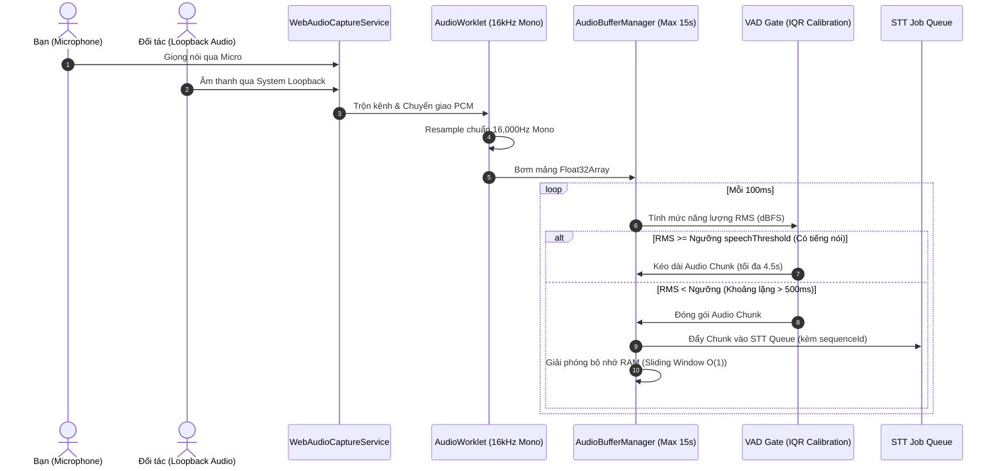
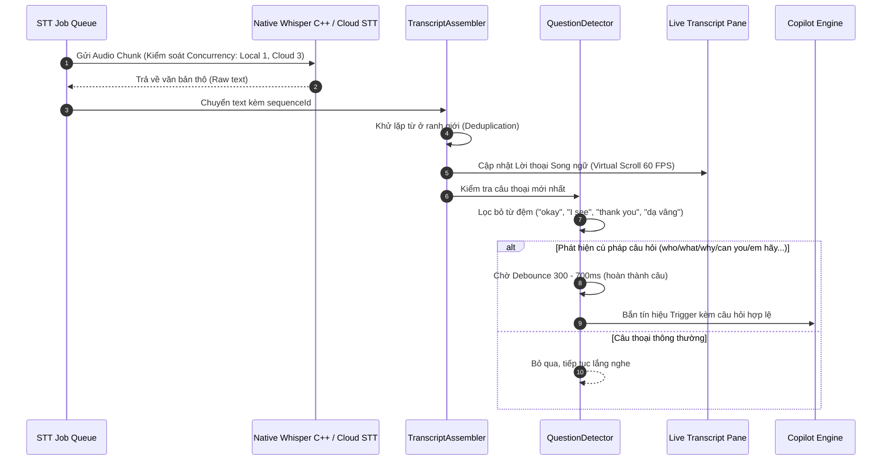
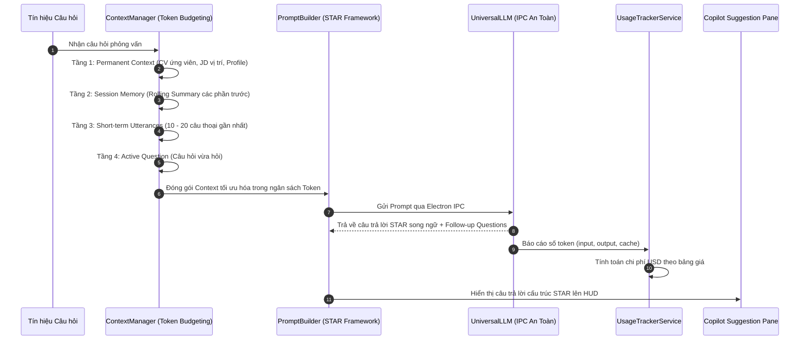
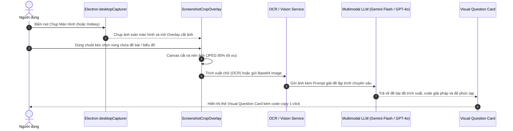
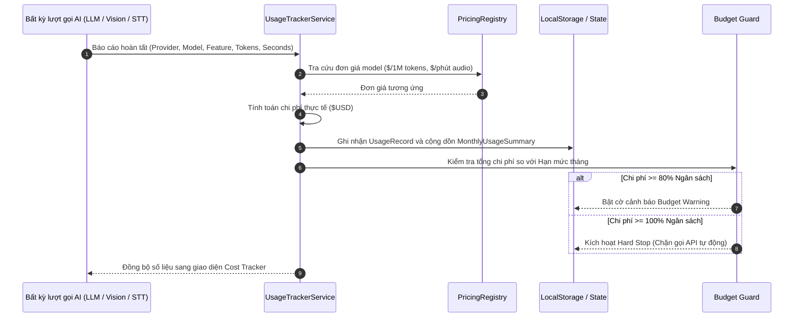

# Electron AI Meeting & Interview Copilot (Election Demo)

> **Ứng dụng desktop Overlay HUD / Copilot thông minh hỗ trợ phỏng vấn tuyển dụng & hội thảo kỹ thuật theo thời gian thực.**  
> Tích hợp công nghệ thu âm 2 chiều đa luồng, bóc băng giọng nói siêu tốc (Local Whisper C++ Native & Cloud STT), phân tích ý định câu hỏi, quản lý ngữ cảnh 4 tầng sinh câu trả lời chuẩn cấu trúc STAR, giải bài tập lập trình thị giác từ màn hình (Screen Vision QA) và bảo mật tuyệt đối với OS Credential Store.

---

## 📑 Bảng Mục Lục

1. [Tổng Quan Dự Án & Điểm Nổi Bật](#-tổng-quan-dự-án--điểm-nổi-bật)
2. [Kiến Trúc Toàn Hệ Thống (System Architecture)](#-kiến-trúc-toàn-hệ-thống-system-architecture)
3. [Chi Tiết 7 Màn Hình Chức Năng](#-chi-tiết-7-màn-hình-chức-năng)
   - [Trang 1: Home (Chuẩn Bị Ngữ Cảnh & Quản Lý Profile)](#trang-1-home-chuẩn-bị-ngữ-cảnh--quản-lý-profile)
   - [Trang 2: Meeting Mode (Trợ Lý Realtime & Giải Đề Thị Giác)](#trang-2-meeting-mode-trợ-lý-realtime--giải-đề-thị-giác)
   - [Trang 3: Audio Test & Lab (Phòng Lab Đo Lường & Cân Chỉnh VAD)](#trang-3-audio-test--lab-phòng-lab-đo-lường--cân-chỉnh-vad)
   - [Trang 4: AI Diagnostic & Benchmark (Đo Tốc Độ AI & OCR Vision)](#trang-4-ai-diagnostic--benchmark-đo-tốc-độ-ai--ocr-vision)
   - [Trang 5: Session History (Quản Lý, Xem Lại & Hậu Kỳ Cuộc Họp)](#trang-5-session-history-quản-lý-xem-lại--hậu-kỳ-cuộc-họp)
   - [Trang 6: Cost Tracker (Quản Lý Ngân Sách & Chi Phí API)](#trang-6-cost-tracker-quản-lý-ngân-sách--chi-phí-api)
   - [Trang 7: Settings & Security (Cấu Hình, Native Engine & Bảo Mật)](#trang-7-settings--security-cấu-hình-native-engine--bảo-mật)
4. [Các Luồng Dữ Liệu Cốt Lõi (Core Workflows)](#-các-luồng-dữ-liệu-cốt-lõi-core-workflows)
5. [Ngăn Xếp Công Nghệ (Tech Stack)](#-ngăn-xếp-công-nghệ-tech-stack)
6. [Yêu Cầu Hệ Thống & Cài Đặt Phát Triển](#-yêu-cầu-hệ-thống--cài-đặt-phát-triển)
7. [Cấu Hình Local Whisper C++ Native](#-cấu-hình-local-whisper-c-native)
8. [Chính Sách Bảo Mật & Dữ Liệu Riêng Tư](#-chính-sách-bảo-mật--dữ-liệu-riêng-tư)

---

## 🌟 Tổng Quan Dự Án & Điểm Nổi Bật

Dự án được xây dựng dưới dạng ứng dụng **Desktop Overlay HUD** chạy trên nền tảng Electron 44, React 19 và TypeScript. Ứng dụng giải quyết bài toán đồng hành theo thời gian thực (realtime copilot) trong các buổi phỏng vấn kỹ thuật hóc búa hoặc các cuộc thảo luận kiến trúc hệ thống phức tạp với các đặc tính nổi trội:

- 🎙️ **Thu âm 2 chiều độc lập (Microphone + System Audio Loopback)**: Thu trọn vẹn cả giọng của bạn lẫn âm thanh đối tác phát ra từ Google Meet, Zoom, Microsoft Teams mà không làm nghẽn luồng xử lý giao diện (chạy trên Web Audio `AudioWorkletNode` 16kHz mono).
- ⚡ **Động cơ STT kép linh hoạt**:
  - **Local Whisper C++ Native**: Bóc băng giọng nói 100% offline trên máy, không gửi audio ra ngoài, tích hợp watchdog giám sát crash/freeze và quản lý tải model GGML.
  - **Cloud STT (Groq Whisper)**: Độ trễ siêu tốc ~120ms cho các trường hợp cần phản hồi tức thì.
- 🎯 **Tự động cân chỉnh VAD theo môi trường phòng (IQR Calibration)**: Thuật toán phân vị tứ phân vị loại bỏ tiếng gõ bàn phím cơ, click chuột, cách ly cấu hình ngưỡng giọng nói riêng biệt theo từng thiết bị phần cứng (`deviceId`).
- 🧠 **Question Intent Detector & Debounce**: Tự động nhận diện câu hỏi từ phía đối tác (who, what, why, can you, em hãy...), áp dụng debounce 300–700ms và lọc bỏ triệt để các câu đệm xã giao ("okay", "thank you", "dạ vâng").
- 📚 **Kiến trúc ngữ cảnh 4 tầng (4-Tier Context Engine)**:
  - *Tầng 1 (Permanent)*: Hồ sơ ứng viên, CV, JD hoặc Chủ đề thảo luận.
  - *Tầng 2 (Session Memory)*: Tóm tắt cuốn chiếu (Rolling Summary) tiến trình cuộc họp.
  - *Tầng 3 (Short-term)*: 10–20 câu thoại trao đổi gần nhất.
  - *Tầng 4 (Active Question)*: Câu hỏi hiện tại đang cần phản hồi.
- 🏆 **Sinh câu trả lời cấu trúc STAR song ngữ**: Hỗ trợ tạo câu trả lời phỏng vấn theo phương pháp STAR (Situation, Task, Action, Result) chuẩn quốc tế bằng tiếng Việt, tiếng Anh hoặc song ngữ, kèm tính năng rút ngắn (Shorten) và dự đoán câu hỏi tiếp theo (Follow-up Questions).
- 👁️ **Giải đề bài thị giác từ màn hình (Screen Vision QA)**: Chụp màn hình qua native `desktopCapturer`, khoanh vùng câu hỏi/sơ đồ bằng `ScreenshotCropOverlay`, tự động OCR và sử dụng Multimodal Vision AI (Gemini 1.5 Flash, GPT-4o) đưa ra lời giải thuật toán kèm phân tích độ phức tạp thời gian/không gian ($O(N)$, $O(1)$).
- 💰 **Quản lý chi phí & Hạn mức ngân sách (Cost Tracker & Budget Guard)**: Giám sát token và chi phí USD theo thời gian thực, thiết lập cảnh báo 80% và ngắt gọi API tự động (Hard Stop) khi chạm 100% ngân sách tháng, hỗ trợ xuất báo cáo CSV.
- 🛡️ **Bảo mật chuẩn cấp hệ điều hành (OS Credential Store)**: Mã hóa API Key bằng Windows DPAPI / macOS Keychain (`safeStorage`), tuyệt đối không lưu plaintext key trên đĩa hay gửi về React Renderer.

---

## 🏗️ Kiến Trúc Toàn Hệ Thống (System Architecture)

Ứng dụng tuân thủ mô hình **Overlay HUD / Copilot đa tầng**, phân tách nghiêm ngặt giữa tiến trình hệ thống và giao diện người dùng:

```
┌────────────────────────────────────────────────────────────────────────┐
│                   ELECTRON MAIN PROCESS (Native C++)                   │
│  - Overlay Window Manager (Frameless, Transparent, Always-on-Top)      │
│  - WhisperProcessManager (Quản lý whisper-cli.exe, Watchdog, Download) │
│  - OS Credential Store (Windows DPAPI / macOS Keychain AES Encryption) │
│  - Electron Desktop Capturer (Chụp màn hình mức hệ thống)              │
│  - Session Storage (Lưu trữ file JSON cục bộ trong userData/sessions/) │
└───────────────────────────────────┬────────────────────────────────────┘
                                    │ (Bảo mật IPC Channels)
┌───────────────────────────────────▼────────────────────────────────────┐
│                  REACT RENDERER PROCESS (Giao Diện HUD)                │
│  - Audio Pipeline: AudioWorklet 16kHz Mono + Bounded Buffer + VAD Gate │
│  - STT Job Queue: Concurrency Worker (Local 1, Cloud 3) + Sequencer   │
│  - Question Detector: Heuristic Intent Filter + Debounce 300-700ms     │
│  - Context Engine: 4-Tier Context Manager (Permanent, Summary, Chat)   │
│  - Screen Vision: Screenshot Crop Overlay + OCR + Multimodal Vision AI │
│  - Cost Engine: Usage Tracker + Pricing Registry + Budget Guard        │
└────────────────────────────────────────────────────────────────────────┘
```

### 1. Electron Main Process (Native Infrastructure)
- **Overlay Window Controller**: Cửa sổ trong suốt (transparent), không viền (frameless), luôn nổi trên cùng (always-on-top) và tự động neo (auto-anchor) sát cạnh màn hình.
- **WhisperProcessManager**: Điều phối tiến trình `whisper-cli.exe` C++, cơ chế watchdog theo dõi tiến trình, tự phục hồi khi crash/freeze, timeout (8–15s), quản lý tải model GGML offline (tiny, base...).
- **OS Credential Store**: Tích hợp `safeStorage` (DPAPI/Keychain) mã hóa tệp `credentials.enc.json`, giải mã trực tiếp trong Main Process khi gửi request tới nhà cung cấp AI. Renderer chỉ nhận trạng thái `configured: true` và chuỗi masked (`gsk_••••••••1234`).
- **Desktop Capturer IPC**: Bắt khung hình màn hình ở cấp độ hệ điều hành phục vụ tính năng giải bài tập lập trình/sơ đồ thị giác.
- **Session Storage**: Quản lý đọc/ghi các phiên làm việc dưới dạng JSON độc lập trong `userData/sessions/`.

### 2. React Renderer Process (UI & Audio/AI Pipeline)
- **Web Audio Pipeline**: Thu âm song song Micro và System Loopback, xử lý trên luồng âm thanh độc lập qua `AudioWorkletNode` 16kHz mono PCM, bộ đệm trượt giới hạn `AudioBufferManager` (tối đa 15s), bộ lọc VAD tự động cân chỉnh theo môi trường.
- **STT Job Queue**: Hàng đợi trung gian điều tiết tải, kiểm soát concurrency (Local: 1 worker chống quá tải CPU, Cloud: 3 workers), gắn `sequenceId`, xử lý backpressure và tự động drop silence chunk.
- **Question Detector**: Phân tích cú pháp câu hỏi siêu tốc kết hợp bộ đệm thời gian debounce 300–700ms.
- **Tiered Context Engine**: Đóng gói prompt tối ưu ngân sách token dựa trên 4 tầng ngữ cảnh.
- **Usage Tracker & Cost Engine**: Tự động tính toán lượng token tiêu thụ và chi phí USD chi tiết cho từng model/feature.

---

## 📄 Chi Tiết 7 Màn Hình Chức Năng

Ứng dụng cung cấp thanh điều hướng chuyên biệt gồm 7 trang chính:

| Trang | Mục Đích Chính | Điểm Nhấn Công Nghệ |
|---|---|---|
| **1. Home** | Chuẩn bị ngữ cảnh, nạp profile, phân tích trước buổi họp | Parser PDF/DOCX/TXT/MD, CV-JD Match Analysis (Heuristic & AI), Test Ping LLM |
| **2. Meeting Mode** | Trợ lý HUD trong cuộc họp & giải đề thị giác | AudioWorklet 60 FPS, Virtual Scrolling transcript, STAR Copilot, Screen Crop OCR/Vision |
| **3. Audio Test & Lab** | Đo kiểm tín hiệu âm thanh & cân chỉnh VAD | Meter dBFS, Phổ tần số 8 băng tần, 5-stage pipeline, VAD Auto-Calibration theo Device ID |
| **4. AI Diagnostic** | Đo tốc độ LLM & thử nghiệm nhận diện Vision | Benchmark TTFT (ms), Tokens/sec, Playground chụp & cắt màn hình kiểm tra OCR/Vision |
| **5. Session History** | Quản lý, xem lại và xuất báo cáo cuộc họp | Master-Detail, Full-Text Search, Unified Timeline tương tác, Xuất Markdown/JSON/PDF |
| **6. Cost Tracker** | Quản lý ngân sách & theo dõi chi phí API | Biểu đồ xu hướng ngày/tháng, phân bổ chi phí, 200 logs gần nhất, Budget Guard 80%/100% |
| **7. Settings & Security** | Cấu hình bảo mật, AI provider & Native Engine | Mã hóa OS Credential Store (DPAPI), Local Whisper C++ manager, Sync Models, VAD config |

---

### TRANG 1: HOME (Chuẩn Bị Ngữ Cảnh & Quản Lý Profile)
*File chính: `src/app/features/home/Home.tsx`*

1. **Hero Launch Bar**:
   - Chuyển đổi linh hoạt giữa 2 chế độ cốt lõi:
     - **Interview Mode**: Tối ưu cho phỏng vấn xin việc (sinh câu trả lời STAR bám sát CV & JD).
     - **Discussion Mode**: Tối ưu cho hội thảo công việc/kỹ thuật (sinh giải pháp, phản biện, kiến trúc hệ thống).
   - Nút **"Bắt đầu cuộc họp"**: Kiểm tra điều kiện an toàn (thiết bị âm thanh, context) trước khi khởi chạy HUD.
2. **Profile Preset Bar (Quản lý Đa Hồ Sơ)**:
   - Lưu trữ và chuyển đổi tức thì nhiều bộ hồ sơ ứng viên khác nhau (VD: *Senior Frontend Engineer*, *DevOps Specialist*, *System Architect*).
   - Hỗ trợ thêm mới, sửa, xóa an toàn (`ProfilePresetDialog`, `ProfileDeleteDialog`) và nhập/xuất dữ liệu hồ sơ qua file JSON chuẩn hóa (`ProfileImportExportDialog`).
3. **Context Editor Card (Soạn Thảo Ngữ Cảnh Tự Động)**:
   - Nhập trực tiếp hoặc tải tệp tài liệu: tự động trích xuất nội dung từ `.pdf` (`unpdf`/`pdfjs`), `.docx` (`mammoth`), `.txt`, `.md` với dung lượng lên đến 15.000 ký tự.
   - Đo lường dung lượng token ngữ cảnh tức thì theo thời gian thực (`estimateTokenCount`).
   - Nút nạp nhanh dữ liệu mẫu (Sample CV Senior Developer, Sample JD Software Engineer, Sample Discussion Topic).
4. **Phân Tích Tương Thích CV - JD (CV-JD Match Analysis)**:
   - Tích hợp 2 cơ chế so khớp:
     - *Heuristic Keyword Matching*: Quét từ khóa kỹ thuật chạy offline ngay lập tức, không tiêu tốn token API.
     - *AI Deep Semantic Matching*: Dùng LLM phân tích chuyên sâu mức độ tương thích năng lực.
   - Hiển thị điểm số tương thích tổng quan (0–100%), danh sách kỹ năng trùng khớp (Matched Skills), kỹ năng còn thiếu (Skill Gaps) và dự đoán các câu hỏi phỏng vấn hóc búa nhất.
5. **Audio Device & AI Model Selector**:
   - Quét và liệt kê danh sách toàn bộ Microphone vật lý và System Audio Loopback trên máy tính.
   - Lựa chọn model AI (Groq, OpenAI, Google Gemini) kèm nút **Test Ping** đo độ trễ HTTP thực tế (Round-trip ping ms).
6. **Recent Sessions & System Quick Status**:
   - Hiển thị danh sách các cuộc họp vừa diễn ra (thời lượng, số câu hỏi).
   - Giám sát tình trạng sẵn sàng của hệ thống: Micro, Whisper Native C++, Trạng thái API Keys, Ngân sách token còn lại.

---

### TRANG 2: MEETING MODE (Trợ Lý Realtime & Giải Đề Thị Giác)
*File chính: `src/app/features/meeting-mode/MeetingMode.tsx`*

1. **Audio Capture 2 Chiều & Visualizer 60 FPS**:
   - Thu âm đồng thời Micro cá nhân + System Loopback Audio (tiếng đối tác phát ra từ Google Meet, Zoom, Teams, Skype...).
   - Xử lý trên `AudioWorkletNode` ở luồng riêng; sóng âm thanh động học (Visualizer) chạy trên vòng lặp `requestAnimationFrame` độc lập ngoài React state $\to$ giữ vững **60 FPS** liên tục.
2. **STT Job Queue & Bóc Băng Tự Động**:
   - Cắt lát audio bằng VAD thành các chunk 1.5s – 4.5s.
   - Điều tiết hàng đợi `sttJobQueue` với concurrency control: Local Whisper = 1 worker (chống nghẽn CPU), Cloud = 3 workers.
   - Gắn `sequenceId` bảo đảm lời thoại hiển thị đúng tuần tự thời gian và tự động drop các đoạn im lặng.
3. **Live Transcript Pane (Lời Thoại Song Ngữ Ảo Hóa)**:
   - Hiển thị lời thoại thời gian thực song ngữ (tiếng Anh bản gốc và bản dịch tiếng Việt mượt mà).
   - Áp dụng kỹ thuật **Ảo hóa danh sách (Virtual Scrolling)**: Đảm bảo cuộc họp kéo dài 90–120 phút với hàng nghìn câu thoại vẫn mượt mà, không giật lag DOM và không tăng đột biến bộ nhớ RAM.
   - Thanh tìm kiếm từ khóa trong transcript, nút bật/tắt tự động cuộn (Auto-scroll), nút xuất nhanh lời thoại ra file `.txt`.
4. **Question Detector & Intent Filter (Bộ Lọc Câu Hỏi Thông Minh)**:
   - Phân tích cú pháp câu hỏi theo thời gian thực (who, what, why, how, can you, em hãy, tại sao...).
   - Debounce thông minh 300–700ms để chờ người phỏng vấn hoàn thành câu nói; lọc bỏ triệt để các câu đệm xã giao ("okay", "I see", "thank you", "great", "dạ vâng").
5. **Tiered Context Copilot & Suggestion Pane**:
   - Kiến trúc Context 4 tầng gom: CV/JD $\to$ Tóm tắt cuộc họp đến hiện tại $\to$ 10–20 câu thoại gần nhất $\to$ Câu hỏi vừa hỏi.
   - Tự động sinh câu trả lời cấu trúc **STAR (Situation, Task, Action, Result)** chuẩn mực cho phỏng vấn kỹ thuật và quản lý.
   - Tùy chọn ngôn ngữ phản hồi linh hoạt: Tiếng Anh, Tiếng Việt hoặc Song ngữ.
   - Các nút tương tác nhanh: **Rút ngắn câu trả lời (Shorten)**, **Tạo lại câu trả lời (Regenerate)**, Copy 1-click.
   - Tự động gợi ý trước các câu hỏi tiếp theo (Follow-up Questions) mà đối tác có thể sắp hỏi.
6. **Screen Capture & Visual Coding QA (Giải Đề Bài Thị Giác Từ Màn Hình)**:
   - Hỗ trợ chụp màn hình chia sẻ trực tiếp khi gặp bài thi lập trình (LeetCode, HackerRank) hoặc sơ đồ hệ thống.
   - `ScreenshotCropOverlay`: Cho phép dùng chuột kéo chọn đúng vùng câu hỏi trên màn hình.
   - Tự động trích xuất OCR văn bản hoặc truyền ảnh vào Multimodal Vision AI (Gemini 1.5 Flash, GPT-4o).
   - `VisualQuestionCard`: Hiển thị đề bài đã trích xuất, code giải pháp tối ưu kèm phân tích độ phức tạp thời gian/không gian ($O(N)$, $O(1)$).
7. **Tự Động Sinh Biên Bản Cuộc Họp & Lưu Session**:
   - Khi kết thúc cuộc họp, hệ thống tự động sinh biên bản tóm tắt cuộc họp (Executive Summary, Key Takeaways, Next Steps).
   - Toàn bộ dữ liệu được lưu an toàn vào `userData/sessions/` trên đĩa cứng.

---

### TRANG 3: AUDIO TEST & LAB (Phòng Lab Đo Lường & Cân Chỉnh VAD)
*File chính: `src/app/features/audio-test/AudioTest.tsx`*

1. **Audio Controls Toolbar**:
   - Chuyển đổi linh hoạt giữa Micro vật lý và System Audio Loopback.
   - Nút Bắt đầu / Dừng thu âm thử nghiệm; tính năng **Ghi âm & Nghe lại (Playback buffer)** để kiểm tra chất lượng giọng nói trước khi vào phỏng vấn; nút tải file âm thanh thử nghiệm `.wav`.
2. **Audio Signal Monitor & Phổ Tần Số**:
   - Đồng hồ đo mức âm lượng VU meter chính xác theo Decibel (-60 dBFS đến 0 dBFS).
   - Phân tích phổ tần số âm thanh 8 băng tần (Frequency Bands Visualizer).
   - Đo thời lượng buffer (Buffer duration) và dung lượng RAM của buffer âm thanh.
3. **Pipeline Stages Card (Giám Sát 5 Chặng Xử Lý)**:
   - Trực quan hóa tiến trình âm thanh theo thời gian thực qua 5 chặng:  
     `Audio Capture` $\to$ `VAD Energy Gate` $\to$ `Resampler 16kHz Mono` $\to$ `STT Job Queue` $\to$ `AI Inference Engine`.
4. **STT Preview Panel & Queue Metrics**:
   - Xem trước kết quả bóc băng giọng nói trực tiếp theo thời gian thực.
   - Hỗ trợ chạy các file audio mẫu có sẵn (YouTube tech interview, business call) để kiểm tra độ nhạy mô hình mà không cần nói.
   - Bảng chỉ số hàng đợi STT: `queueDepth`, `processingJobs`, `droppedJobs`, `averageWaitTime`.
5. **Tự Động Cân Chỉnh VAD Theo Môi Trường (Automatic VAD Calibration Modal)**:
   - Thu mẫu môi trường phòng trong 3.0 giây (60 khung 50ms) bằng chính pipeline âm thanh thực tế.
   - Thuật toán phân vị tứ phân vị ($IQR = Q3 - Q1$) loại trừ hoàn toàn các tiếng ồn đột ngột (click chuột, gõ bàn phím cơ, tiếng thở).
   - Tính toán noise floor ở phân vị 65th và cộng thêm `safetyMargin` (+3dB, +6dB, +9dB) để suy ra ngưỡng kích hoạt giọng nói (`speechThreshold`).
   - Phân loại chất lượng môi trường phòng: `pristine` (cực yên tĩnh), `good`, `moderate`, `noisy`, `critical`.
   - **Device Isolation**: Lưu trữ ngưỡng VAD độc lập cho từng mã phần cứng Micro (`deviceId`). Khi chuyển Micro, Meeting Mode tự động nạp cấu hình VAD tương ứng.

---

### TRANG 4: AI DIAGNOSTIC & BENCHMARK (Đo Tốc Độ AI & OCR Vision)
*File chính: `src/app/features/ai-diagnostic/AIDiagnostic.tsx`*

1. **Tab 1: LLM Latency & Speed Benchmark**:
   - Cho phép chọn bất kỳ model LLM nào từ Groq, OpenAI hoặc Google Gemini.
   - Cung cấp các mẫu prompt thử nghiệm thực tế: *Giải thuật toán LeetCode*, *Câu hỏi phỏng vấn System Design*, *Dịch thuật kỹ thuật*.
   - Đo lường và hiển thị các chỉ số hiệu năng AI chuẩn xác:
     - **TTFT (Time to First Token)**: Thời gian từ lúc gửi yêu cầu đến khi nhận được ký tự đầu tiên (ms).
     - **Tốc độ sinh token (Tokens/sec)**: Tốc độ tạo chữ thực tế của model.
     - **Tổng thời gian xử lý (Total Latency ms)**.
     - **Số lượng token tiêu thụ**: Input tokens, Output tokens và chi phí ước tính.
2. **Tab 2: Screen Capture Vision & OCR Playground**:
   - Thử nghiệm chụp ảnh màn hình bằng native Electron `desktopCapturer`.
   - Cung cấp công cụ cắt ảnh tương tác (Crop Tool) để khoanh vùng bài toán hoặc biểu đồ.
   - Lựa chọn Multimodal Vision Model (Google Gemini 1.5 Flash, OpenAI GPT-4o-mini...).
   - Chạy thử nghiệm phân tích đề bài thị giác và xem trước kết quả OCR trích xuất trước khi bước vào cuộc họp chính thức.

---

### TRANG 5: SESSION HISTORY (Quản Lý, Xem Lại & Hậu Kỳ Cuộc Họp)
*File chính: `src/app/features/session-history/SessionHistory.tsx`*

1. **Bố Cục Master-Detail & Sidebar Đa Bộ Lọc**:
   - Lọc theo chế độ: Tất cả, Phỏng vấn (Interview), Thảo luận (Discussion).
   - Lọc theo Profile ứng viên: *Frontend Dev*, *DevOps Lead*...
   - Lọc theo mốc thời gian: *Hôm nay*, *7 ngày qua*, *30 ngày qua*, *Tất cả*.
   - **Full-Text Search Toàn Diện**: Tìm kiếm tức thì trong toàn bộ tiêu đề, transcript tiếng Anh, transcript dịch tiếng Việt, gợi ý của AI và nội dung OCR từ ảnh chụp màn hình.
   - Thao tác quản lý session: Đổi tên cuộc họp trực tiếp (inline rename), xóa từng session hoặc chọn nhiều để xóa hàng loạt (Bulk Delete) kèm hộp thoại xác nhận an toàn.
2. **Interactive Timeline & Chi Tiết Cuộc Họp**:
   - Header hiển thị tổng quan: Ngày giờ, thời lượng, profile áp dụng, tổng token sử dụng và ước tính chi phí API ($USD).
   - **Tab 1 - Dòng thời gian tích hợp (Unified Timeline)**: Liệt kê sự kiện theo thời gian thực với phân loại màu sắc trực quan:
     - *Câu hỏi người phỏng vấn* (Theme màu hổ phách, nhãn Question).
     - *Câu trả lời của bạn* (Theme màu tím, nhãn You).
     - *Gợi ý AI STAR Copilot* (Theme phát sáng emerald/violet, nhãn AI Suggestion kèm nút copy).
     - *Câu hỏi hình ảnh màn hình* (Theme cyan/indigo, trích xuất OCR, tóm tắt và code thuật toán).
   - **Tính năng Click-to-Correlate**: Bấm vào mốc thời gian của bất kỳ sự kiện nào để tự động cuộn và highlight câu hỏi hoặc gợi ý AI tương ứng.
   - **Tab 2 - Lời thoại song ngữ (Transcript)**: Xem toàn bộ hội thoại gốc và dịch với chế độ progressive load chống giật lag.
   - **Tab 3 - Gợi ý AI Copilot**: Toàn bộ câu trả lời STAR kèm số token tiêu thụ.
   - **Tab 4 - Visual Coding**: Toàn bộ ảnh chụp màn hình bài tập kèm code lời giải.
   - **Tab 5 - Split View (50:50)**: Đối chiếu song song lời thoại và gợi ý của AI.
3. **Xuất Báo Cáo Đa Định Dạng**:
   - **Xuất Markdown**: Báo cáo đầy đủ định dạng đẹp (kèm Profile, Timeline, Lời thoại song ngữ, Gợi ý STAR, Câu hỏi hình ảnh OCR, Metrics).
   - **Xuất JSON Schema v2.0**: Dữ liệu cấu trúc chuẩn phục vụ sao lưu hoặc phân tích dữ liệu.
   - **Xuất PDF in ấn**: Xuất file tài liệu PDF trực tiếp bằng hàm in hệ thống.
4. **Chính Sách Lưu Trữ Tự Động (Retention Policy)**:
   - Tùy chọn tự động dọn dẹp các phiên họp cũ: Vĩnh viễn (mặc định), 7 ngày, 30 ngày, 90 ngày.
   - Tự động dọn dẹp sạch sẽ artifact ảnh chụp màn hình liên quan khi phiên họp bị xóa.

---

### TRANG 6: COST TRACKER (Quản Lý Ngân Sách & Chi Phí API)
*File chính: `src/app/features/cost-tracker/CostTracker.tsx`*

1. **Top Metric Cards (Chỉ Số Tổng Quan Hàng Tháng)**:
   - Hiển thị tức thì: Tổng chi phí tháng hiện tại ($USD), Tổng số lượt gọi API (Requests), Tổng số token tiêu thụ (Input / Output / Cache), Tỷ lệ ngân sách đã dùng (%).
2. **Tab 1: Overview Dashboard (Bàn Điều Khiển Tổng Thể)**:
   - Kết hợp 2 cột: Biểu đồ xu hướng chi phí theo ngày và Biểu đồ tròn phân bổ chi phí.
   - Thẻ quản lý ngân sách và thẻ cấu hình bảng giá model.
3. **Tab 2: Daily Usage Trend Chart (Biểu Đồ Xu Hướng Sử Dụng)**:
   - Trực quan hóa chi phí theo từng ngày với các mốc lựa chọn: 7 ngày, 14 ngày, 30 ngày.
   - Phân tích ngày có lượng gọi API cao nhất (Spike detection) và mức chi tiêu trung bình/ngày.
4. **Tab 3: Distribution Charts (Biểu Đồ Phân Bổ Chi Phí)**:
   - Phân bổ theo **Nhà cung cấp (Provider)**: Tỷ lệ % chi phí giữa Groq, OpenAI, Google Gemini.
   - Phân bổ theo **Tính năng (Feature)**: Tỷ lệ giữa `copilot_interview`, `copilot_discussion`, `speech_to_text`, `summary`, `vision_analysis`.
5. **Tab 4: Recent Usage Logs Table (Nhật Ký Gọi API Chi Tiết)**:
   - Bảng liệt kê chi tiết 200 lượt gọi API gần nhất: Mã request, Thời gian, Provider, Model, Tính năng, Input Tokens, Output Tokens, Cached Tokens, Chi phí USD, Trạng thái.
   - Nút **Xuất file CSV (Export CSV)**: Tải toàn bộ nhật ký gọi API ra file Excel/CSV để lập báo cáo tài chính.
6. **Tab 5: Budget Management (Quản Lý Hạn Mức Chi Tiêu)**:
   - Thiết lập hạn mức ngân sách tối đa hàng tháng ($USD).
   - Thiết lập ngưỡng cảnh báo (Warning threshold, mặc định 80%).
   - Cơ chế bảo vệ: Cảnh báo trực quan khi chạm ngưỡng và chặn gọi API không cần thiết (Hard Stop) khi vượt hạn mức 100%.
7. **Tab 6: Model Pricing Configuration (Cấu Hình Đơn Giá Token)**:
   - Cho phép người dùng tùy chỉnh hoặc cập nhật giá tiền cho từng model (Input price / 1M tokens, Output price / 1M tokens, Cached price / 1M tokens, Audio price / minute).
   - Hỗ trợ nạp dữ liệu mẫu (Seed Demo Data) và Reset toàn bộ thống kê cục bộ.

---

### TRANG 7: SETTINGS & SECURITY (Cấu Hình, Native Engine & Bảo Mật)
*File chính: `src/app/features/settings/Settings.tsx`*

1. **Khóa API AI (Bảo Mật Bằng OS Credential Store)**:
   - Tích hợp chuẩn mã hóa cấp OS: **Windows Credential Manager / DPAPI, macOS Keychain**.
   - Tuyệt đối không lưu plaintext key trong `localStorage`, `IndexedDB` hay file JSON cấu hình.
   - Renderer chỉ nhận trạng thái `configured: true` và `maskedKey` (`gsk_••••••••1234`).
   - Quản lý độc lập 3 Provider: Groq, OpenAI, Google Gemini.
   - Nút **Kiểm tra khóa (Verify API Key)**: Ping xác thực key sống/chết và cập nhật danh sách model hỗ trợ.
   - Nút **Thu hồi/Xóa khóa (Revoke Key)** và **Tự động di chuyển (Auto Migration)** từ key cũ sang vùng lưu trữ an toàn.
   - Nút **Xuất cấu hình an toàn (Export Sanitized Settings)**: Xuất file cấu hình đã loại bỏ 100% secret.
2. **STT Engine Card (Động Cơ Bóc Băng Giọng Nói)**:
   - Lựa chọn giữa **Local Whisper C++** (chạy offline trên máy) và **Cloud STT** (Groq Whisper siêu tốc 120ms).
   - Quản lý Native Worker Whisper C++: Theo dõi trạng thái tiến trình (`READY`, `BUSY`, `STOPPED`, `FAILED`), đo nhiệt độ/CPU và quản lý tải model GGML offline (tiny 75MB, base 142MB).
   - Nút **Kiểm tra sức khỏe Native Engine (Health Check)**: Thử nghiệm bóc băng đoạn audio mẫu nội bộ để xác nhận binary và model hoạt động trơn tru.
3. **LLM Engine Card (Mô Hình AI Copilot)**:
   - Lựa chọn model LLM mặc định cho cuộc họp (Llama 3.3 70B, GPT-4o, Gemini 2.5 Flash...).
   - Nút **Đồng bộ danh sách model (Sync Models)** trực tiếp từ API của từng provider.
4. **Multimodal Vision Model Card**:
   - Cấu hình model chuyên trách xử lý hình ảnh chụp màn hình (Gemini 1.5 Flash, GPT-4o-mini...).
5. **Meeting Audio & VAD Config Card**:
   - Chọn Microphone mặc định.
   - Thanh trượt điều chỉnh độ nhạy VAD (0.1 – 1.0) và độ dài khoảng lặng kết thúc câu.
   - Lựa chọn ngôn ngữ phản hồi mặc định của AI: Tiếng Việt, Tiếng Anh, Song ngữ.
   - Bật/tắt chế độ cá nhân hóa câu trả lời dựa trên kinh nghiệm trong CV.

---

## 🔄 Các Luồng Dữ Liệu Cốt Lõi (Core Workflows)

Dưới đây là 6 luồng dữ liệu chính vận hành toàn bộ hệ thống:

### Luồng 1: Thu Âm 2 Chiều & Lọc Khoảng Lặng VAD


---

### Luồng 2: Bóc Băng STT & Nhận Diện Ý Định Câu Hỏi


---

### Luồng 3: Quản Lý Ngữ Cảnh 4 Tầng & Phản Hồi STAR Copilot


---

### Luồng 4: Chụp Màn Hình & Giải Đề Bài Thị Giác


---

### Luồng 5: Giám Sát Chi Phí & Hạn Mức Ngân Sách


---

### Luồng 6: Bảo Mật Khóa API & Mã Hóa Native

```mermaid
sequenceDiagram
    autonumber
    actor User as Người dùng (Settings)
    participant Renderer as React Renderer
    participant IPC as Electron IPC Channel
    participant SafeStore as OS safeStorage (DPAPI / Keychain)
    participant Disk as File credentials.enc.json
    participant Cloud as AI Cloud Server (Groq / OpenAI / Google)

    User->>Renderer: Nhập API Key (vd: gsk_123456789)
    Renderer->>IPC: Gửi payload qua channel credentials:save
    IPC->>SafeStore: Gọi safeStorage.encryptString(apiKey)
    SafeStore-->>IPC: Trả về Buffer mã hóa AES bằng khóa cấp OS
    IPC->>Disk: Ghi Buffer mã hóa xuống đĩa
    IPC-->>Renderer: Chỉ trả về { configured: true, maskedKey: 'gsk_••••••••6789' }
    Note over Renderer: Tuyệt đối KHÔNG lưu plaintext key trong bộ nhớ trình duyệt!
    
    rect rgb(30, 41, 59)
    Note over Renderer,Cloud: Khi cần gọi AI Inference:
    Renderer->>IPC: Gửi prompt và modelId (không gửi API Key)
    IPC->>Disk: Đọc Buffer mã hóa
    IPC->>SafeStore: Giải mã safeStorage.decryptString() trong Main Process
    IPC->>Cloud: Thực hiện HTTPS Request trực tiếp kèm Authorization Header
    Cloud-->>IPC: Trả về kết quả AI
    IPC-->>Renderer: Trả về nội dung phản hồi
    end
```


---

## 💻 Ngăn Xếp Công Nghệ (Tech Stack)

| Thành Phần | Công Nghệ Sử Dụng | Vai Trò & Chức Năng |
|---|---|---|
| **Core Framework** | **Electron 44** + **Node.js** | Nền tảng desktop, quản lý tiến trình Main, cửa sổ Overlay, Native IPC |
| **Frontend UI** | **React 19** + **TypeScript** + **Vite 8** | Giao diện HUD hiện đại, tương tác tốc độ cao, type-safety |
| **Styling** | **TailwindCSS** + **Lucide Icons** | Thiết kế giao diện Glassmorphism tối ưu, biểu tượng trực quan |
| **Audio Processing** | **Web Audio API** + **AudioWorkletNode** | Xử lý audio 16kHz mono trên luồng riêng biệt, phân tích phổ tần số |
| **Native STT** | **Whisper.cpp** (`whisper-cli.exe`) | Nhận dạng giọng nói ngoại tuyến, mô hình GGML (tiny, base) |
| **Cloud STT & LLM**| **Groq LPU** (Whisper, Llama 3.3 70B) | STT siêu tốc 120ms và suy luận ngôn ngữ độ trễ thấp |
| **AI Providers** | **OpenAI** (GPT-4o), **Google** (Gemini 1.5/2.5) | Mô hình ngôn ngữ lớn và mô hình thị giác đa phương thức (Vision) |
| **Document Parser** | **unpdf** / **pdfjs** + **mammoth** | Trích xuất văn bản từ tài liệu PDF và DOCX ngay tại máy |
| **Bảo Mật** | **Electron safeStorage** (DPAPI/Keychain) | Mã hóa AES các API credentials cấp hệ điều hành |
| **Package Manager** | **Bun** | Quản lý gói thư viện và thực thi scripts siêu tốc |

---

## 🚀 Yêu Cầu Hệ Thống & Cài Đặt Phát Triển

### Yêu Cầu Hệ Thống:
- **Hệ điều hành**: Windows 10/11 64-bit (khuyến nghị cho bản build Local Whisper native) hoặc macOS/Linux.
- **Runtime**: [Bun](https://bun.sh/) (hoặc Node.js >= 20.x).
- **Phần cứng**: Microphone hoặc Card âm thanh hỗ trợ System Loopback Audio (Stereo Mix).
- **API Keys**: Khóa API từ ít nhất một trong các nhà cung cấp: Groq, OpenAI, Google Gemini (được cấu hình trực tiếp trong Settings).

### Cài Đặt Và Chạy Ứng Dụng:

1. Clone mã nguồn dự án:
   ```powershell
   git clone <URL_REPOSITORY>
   cd election-demo
   ```

2. Cài đặt các gói phụ thuộc bằng Bun:
   ```powershell
   bun install
   ```

3. Khởi chạy ứng dụng trong môi trường phát triển (Dev Mode):
   ```powershell
   bun run dev
   ```
   *Lệnh này sẽ tự động biên dịch mã nguồn Electron, khởi chạy Vite Dev Server và mở cửa sổ ứng dụng desktop.*

4. Đóng gói kiểm tra (Build):
   ```powershell
   bun run build
   ```

---

## 🎙️ Cấu Hình Local Whisper C++ Native

Để sử dụng chế độ bóc băng giọng nói **100% Offline** không cần kết nối internet:

1. Đặt tệp thực thi `whisper-cli.exe` vào thư mục:
   ```
   resources/bin/whisper-cli.exe
   ```
   *(Xem hướng dẫn chi tiết tại [`resources/bin/README.txt`](file:///d:/DEV/Election-Demo/resources/bin/README.txt))*

2. Tải mô hình GGML (định dạng `.bin`, ví dụ `ggml-tiny.bin` hoặc `ggml-base.bin`) và đặt vào:
   ```
   resources/models/ggml-base.bin
   ```
   *(Xem hướng dẫn chi tiết tại [`resources/models/README.txt`](file:///d:/DEV/Election-Demo/resources/models/README.txt))*

3. Mở ứng dụng, vào **Settings** $\to$ **STT Engine**, chọn **Local Whisper C++** và bấm **Health Check** để xác nhận engine đã sẵn sàng hoạt động.

> [!NOTE]
> Do kích thước lớn, các file nhị phân `.exe` và model `.bin` được đưa vào `.gitignore` và không commit lên kho mã nguồn Git.

---

## 🔒 Chính Sách Bảo Mật & Dữ Liệu Riêng Tư

1. **Bảo Mật API Key Tuyệt Đối**:
   - Tất cả API Key đều được mã hóa bằng **Windows DPAPI** (trên Windows) hoặc **Apple Keychain** (trên macOS) thông qua API native `safeStorage` của Electron.
   - Không lưu secret dưới dạng plaintext trong `localStorage`, `IndexedDB` hay git repository.
   - Renderer chỉ nhận diện khóa dưới dạng đã che: `gsk_••••••••1234`.

2. **Dữ Liệu Cuộc Họp Lưu Cục Bộ**:
   - Toàn bộ hồ sơ ứng viên (Profiles), nội dung CV, JD, bản ghi âm, transcript và kết quả phân tích AI đều được lưu trữ trực tiếp trên máy người dùng trong thư mục `userData/sessions/`.
   - Người dùng có toàn quyền xem, tìm kiếm, chỉnh sửa, xóa từng phần hoặc xóa sạch toàn bộ lịch sử.

3. **Chính Sách Chuyển Giao Dữ Liệu Đám Mây**:
   - Khi sử dụng Local Whisper C++, dữ liệu âm thanh hoàn toàn không rời khỏi máy tính của bạn.
   - Khi sử dụng Cloud STT hoặc Cloud LLM, chỉ các đoạn audio/text liên quan đến câu hỏi mới được gửi qua kết nối HTTPS bảo mật tới nhà cung cấp tương ứng theo chính sách quyền riêng tư của họ.

---

## 📄 Bản Quyền & Giấy Phép (License)

Dự án phát triển nội bộ cho mục đích nghiên cứu, demo và hỗ trợ phỏng vấn/cuộc họp. Mọi quyền được bảo lưu.
